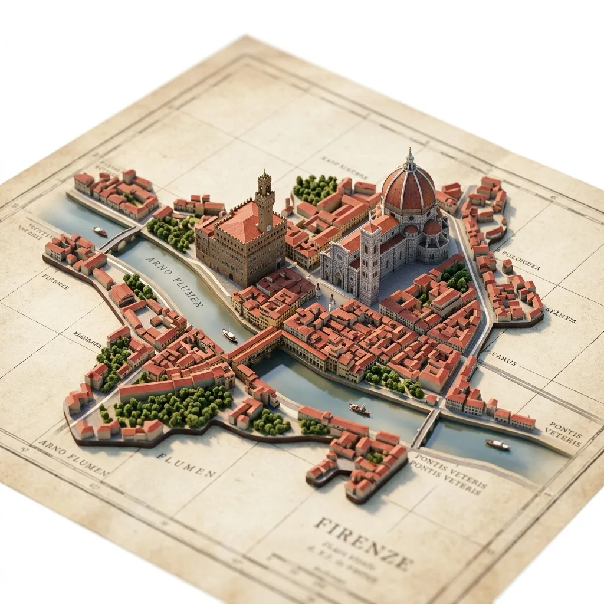

# Highly detailed, true-to-life photorealistic miniature diorama style isometric map

[← Back to the collection](../../README.md) · Category: [Illustration & 3D](../../gallery/illustration-3d.md) · Model: `Vinano Image Pro` · ID: `vn-00849`

<a href="https://vinano.ai?utm_source=github&utm_medium=readme&utm_campaign=awesome-image-video-prompts-updating&utm_content=prompt-page-image"></a>

<sub>Preview generated with <a href="https://vinano.ai?utm_source=github&utm_medium=readme&utm_campaign=awesome-image-video-prompts-updating&utm_content=prompt-page-caption">vinano.ai</a></sub>

## Prompt

```text
{
"description": "Create a highly detailed, true-to-life photorealistic miniature diorama style isometric map of [CITY/LOCATION] placed on a vintage textured paper map.",
 "perspective": {
 "type": "isometric",
 "angle": "45 degree top down",
 "look": "macro photography tilt-shift miniature effect"
 },
 "geography": {
 "shape": "follows real geographic shape of [CITY/LOCATION]",
 "landmarks": {
 "oversized": true,
 "dominant": true,
 "primary_focus": "monuments",
 "secondary_elements": "smaller and simplified"
 },
 "architecture": "ultra detailed miniature",
 "roads": "selective",
 "greenery": true,
 "water_bodies": true,
 "terrain": true,
 "materials": ["stone", "wood", "concrete", "glass", "foliage"]
 },
 "lighting": {
 "type": "soft cinematic daylight",
 "effects": ["natural shadows", "warm highlights", "subtle atmospheric depth"]
 },
 "water": {
 "rivers": true,
 "coastlines": true,
 "depth_gradients": "smooth",
 "reflections": "gentle"
 },
 "map_base": {
 "type": "old world cartographic paper",
 "features": ["visible grid lines", "paper grain", "printed place names"]
 },
 "focus": {
 "sharp_on_landmarks": true,
 "edge_falloff": "gentle"
 },
 "quality": {
 "museum_quality": true,
 "handcrafted_diorama_realism": true,
 "ultra_high_resolution": true
 },
 "background": {
 "color": "clean pure white",
 "restrictions": ["no floating text", "no logos", "no watermarks", "no futuristic or cartoon elements"]
 },
 "aspect_ratio": "4:5"
}

Render with rich micro-detail while keeping the layout uncluttered and intentional.
```

## Try it on vinano.ai

1. Copy the prompt above.
2. Open **[vinano.ai](https://vinano.ai?utm_source=github&utm_medium=readme&utm_campaign=awesome-image-video-prompts-updating&utm_content=prompt-page-try)**, paste it into the image generator and pick a model.
3. Swap any placeholders (brand, product, city, person…) for your own details, then generate.

More prompts like this: [Illustration & 3D gallery](../../gallery/illustration-3d.md) · [all categories](../../README.md#contents)
