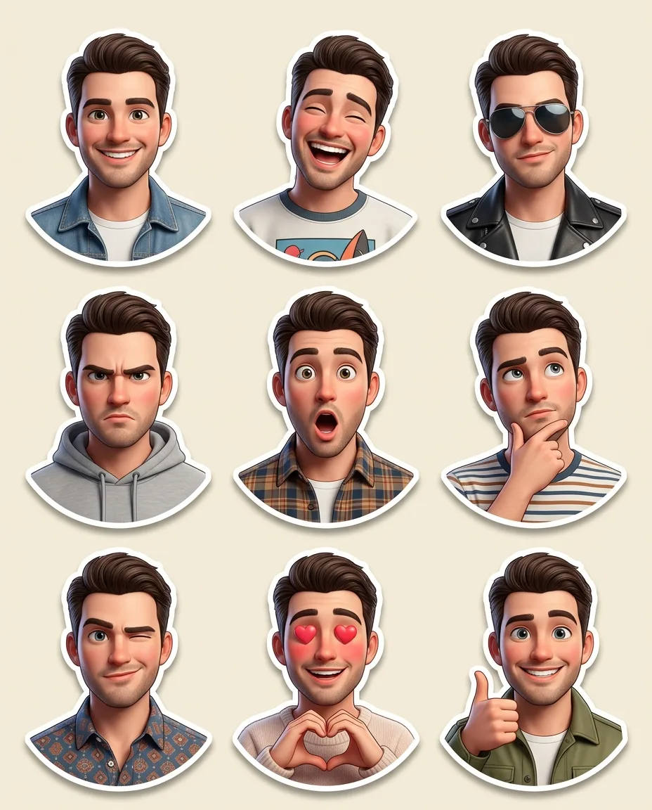

# Premium Pixar-style 3D character sticker set that is clearly

[← Back to the collection](../../README.md) · Category: [Illustration & 3D](../../gallery/illustration-3d.md) · Model: `Vinano Image Pro` · ID: `vn-00851`

<a href="https://vinano.ai?utm_source=github&utm_medium=readme&utm_campaign=awesome-image-video-prompts-updating&utm_content=prompt-page-image"></a>

<sub>Preview generated with <a href="https://vinano.ai?utm_source=github&utm_medium=readme&utm_campaign=awesome-image-video-prompts-updating&utm_content=prompt-page-caption">vinano.ai</a></sub>

## Prompt

```text
Create a premium Pixar-style 3D character sticker set that is clearly recognizable as the same person. Use the uploaded image as the ONLY facial reference.
Output Requirements:
3×3 grid layout (9 stickers total)
Final aspect ratio: 4:5
Ultra high resolution (8K)
Clean cream background
Each sticker is separated clear spacing
Add a subtle drop shadow under each sticker for depth
Character Identity (VERY IMPORTANT):
MUST preserve exact facial structure, hairstyle, grooming details, and unique features from the uploaded image
Maintain high likeness accuracy
Do NOT over beautify or alter identity beyond recognition
Style:
Pixar-style 3D animation
Glossy, high-end rendering
Soft global illumination
Smooth shading
High-detail facial textures
Framing:
All stickers must be head and shoulders (portrait close-up) only
No full-body or mid-body shots allowed
Focus tightly on face and upper shoulders to emphasize expressions
Outfit:
Modern casual and slightly stylized clothing
Each sticker must have a different outfit (no repetition at all)
Clean, minimal, and visually appealing for sticker use
Expressions & Poses (9 variations):
1. Happy smile
2. Laughing
3. Cool (sunglasses)
4. Angry/serious
5. Surprised
6. Thinking
7. Wink
8. Love (heart eyes and heart gesture)
9. Thumbs up
Sticker Design:
Bold, clean outline
Slightly exaggerated cartoon proportions
Strong emphasis on facial expressions
Optimized for digital sticker platforms
Each sticker must have a smooth rounded bottom cutout (semi-curved base)
No text
Lighting:
Soft studio lighting
Subtle rim light for depth and separation
Goal:
Create a highly engaging, cute, and expressive sticker pack that feels premium and collectable.

Render with rich micro-detail while keeping the layout uncluttered and intentional.
```

## Try it on vinano.ai

1. Copy the prompt above.
2. Open **[vinano.ai](https://vinano.ai?utm_source=github&utm_medium=readme&utm_campaign=awesome-image-video-prompts-updating&utm_content=prompt-page-try)**, paste it into the image generator and pick a model.
3. Swap any placeholders (brand, product, city, person…) for your own details, then generate.

More prompts like this: [Illustration & 3D gallery](../../gallery/illustration-3d.md) · [all categories](../../README.md#contents)
