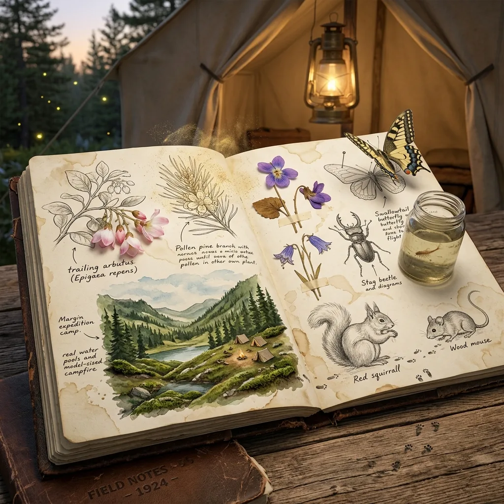

# Epic 3D scene

[← Back to the collection](../../README.md) · Category: [Illustration & 3D](../../gallery/illustration-3d.md) · Model: `Vinano Image v2` · ID: `vn-00854`

<a href="https://vinano.ai?utm_source=github&utm_medium=readme&utm_campaign=awesome-image-video-prompts-updating&utm_content=prompt-page-image"></a>

<sub>Preview generated with <a href="https://vinano.ai?utm_source=github&utm_medium=readme&utm_campaign=awesome-image-video-prompts-updating&utm_content=prompt-page-caption">vinano.ai</a></sub>

## Prompt

```text
Epic 3D scene: a weathered field journal lies open on a naturalist's camp table, its pages erupting into the ecosystems they document. Hand-drawn botanical illustrations push upward into living specimens: [PLANT 1] unfurls actual petals, [PLANT 2] releases pollen that drifts across the spread. Pinned insect diagrams detach and take flight. Watercolor landscapes inflate into traversable terrain. Margin notes become tiny expedition camps. Pressed flowers resurrect in time-lapse bloom. A specimen jar on the page contains an actual swimming creature. Field sketches of [ANIMAL] step off the paper, leaving graphite footprints. Coffee-stained pages become amber pools. Canvas tent visible beyond, lantern light mixing fireflies, the smell of pine and old paper, 8K, true-to-life photorealistic documentary aesthetic Maintain consistent colour harmony and crisp focus across the whole frame.
```

## Try it on vinano.ai

1. Copy the prompt above.
2. Open **[vinano.ai](https://vinano.ai?utm_source=github&utm_medium=readme&utm_campaign=awesome-image-video-prompts-updating&utm_content=prompt-page-try)**, paste it into the image generator and pick a model.
3. Swap any placeholders (brand, product, city, person…) for your own details, then generate.

More prompts like this: [Illustration & 3D gallery](../../gallery/illustration-3d.md) · [all categories](../../README.md#contents)
