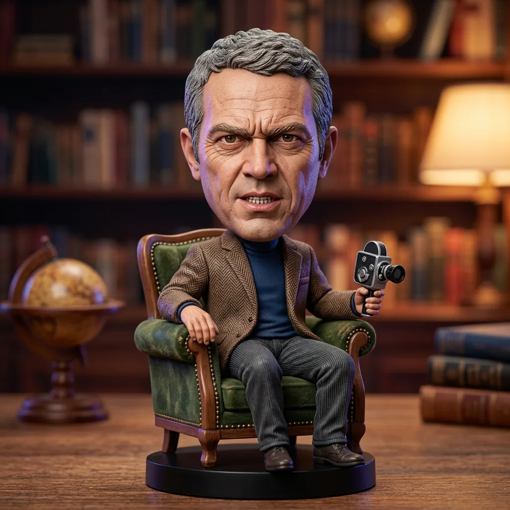

# Highly detailed caricature figurine of SUBJECT as a cute

[← Back to the collection](../../README.md) · Category: [Illustration & 3D](../../gallery/illustration-3d.md) · Model: `Vinano Image v2` · ID: `vn-00875`

<a href="https://vinano.ai?utm_source=github&utm_medium=readme&utm_campaign=awesome-image-video-prompts-updating&utm_content=prompt-page-image"></a>

<sub>Preview generated with <a href="https://vinano.ai?utm_source=github&utm_medium=readme&utm_campaign=awesome-image-video-prompts-updating&utm_content=prompt-page-caption">vinano.ai</a></sub>

## Prompt

```text
Highly detailed caricature figurine of [SUBJECT] as a cute but intense bobblehead-style collectible statue, exaggerated oversized head hyper-realistic facial features, deep wrinkles, fierce intense expression, slightly open mouth showing teeth, sitting relaxed in a vintage armchair, wearing [OUTFIT], dramatic colorful studio lighting, [BACKGROUND], modern collectible toy photography style, sharp focus, cinematic depth of field, extremely intricate sculpting details, realistic skin texture, professional product photography, 8k quality Keep edges clean and the overall composition balanced for a polished, gallery-ready result.
```

## Try it on vinano.ai

1. Copy the prompt above.
2. Open **[vinano.ai](https://vinano.ai?utm_source=github&utm_medium=readme&utm_campaign=awesome-image-video-prompts-updating&utm_content=prompt-page-try)**, paste it into the image generator and pick a model.
3. Swap any placeholders (brand, product, city, person…) for your own details, then generate.

More prompts like this: [Illustration & 3D gallery](../../gallery/illustration-3d.md) · [all categories](../../README.md#contents)
