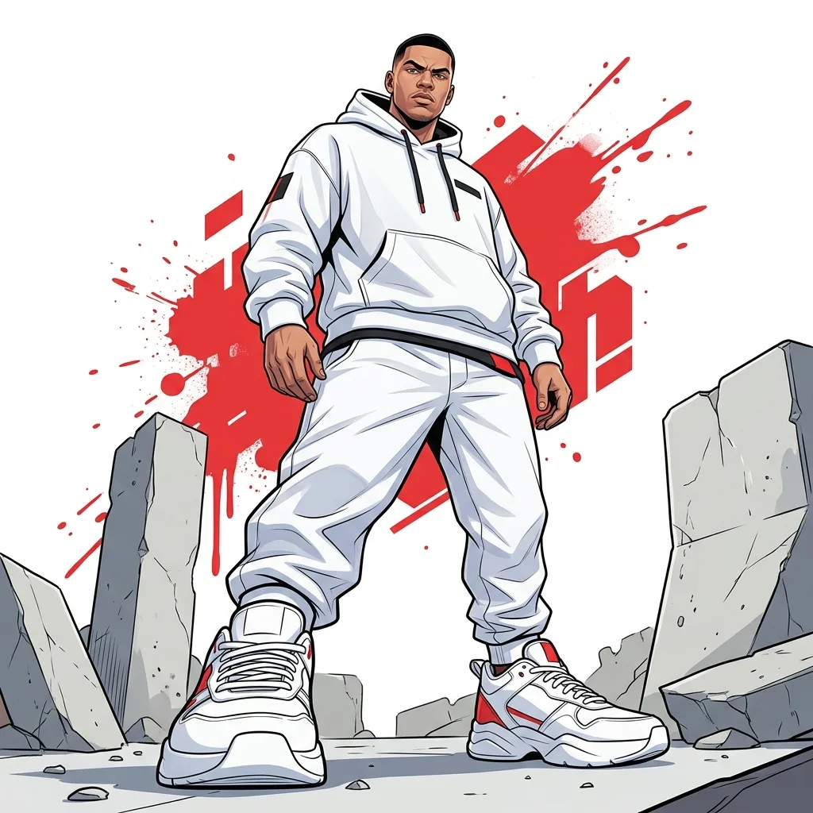

# Illustration & 3D prompt #888

[← Back to the collection](../../README.md) · Category: [Illustration & 3D](../../gallery/illustration-3d.md) · Model: `Vinano Image Pro` · ID: `vn-00888`

<a href="https://vinano.ai?utm_source=github&utm_medium=readme&utm_campaign=awesome-image-video-prompts-updating&utm_content=prompt-page-image"></a>

<sub>Preview generated with <a href="https://vinano.ai?utm_source=github&utm_medium=readme&utm_campaign=awesome-image-video-prompts-updating&utm_content=prompt-page-caption">vinano.ai</a></sub>

## Prompt

```text
A dynamic full-body urban illustration of a man (use the exact face from the provided reference image, ensuring high facial accuracy and identity preservation). He wears an oversized white hoodie subtle black and red accents, paired loose white track pants and bold, eye-catching white sneakers.
The character has a sharp, confident gaze directed forward, conveying intensity and self-assurance. The composition is captured from a dramatic low-angle perspective, emphasizing power and dominance. His stance is strong and grounded, exaggerated perspective on the sneakers in the foreground for added depth.
Surrounding him are fragmented concrete elements and subtle debris, suggesting an urban, gritty environment. The background is a clean white canvas featuring bold red paint splashes and abstract geometric shapes, creating a modern street-art aesthetic.
The visual style combines crisp, clean line art vibrant flat colors and soft cel shading for depth and dimension. The rendering should feel like a high-end urban illustration or stylized editorial artwork.
Lighting is bright, even, and diffused across the entire scene, minimizing harsh shadows while maximizing clarity and detail.
Ultra-detailed, sharp focus, 8K resolution, vertical composition

Aim for an editorial, design-driven look with deliberate negative space.
```

## Try it on vinano.ai

1. Copy the prompt above.
2. Open **[vinano.ai](https://vinano.ai?utm_source=github&utm_medium=readme&utm_campaign=awesome-image-video-prompts-updating&utm_content=prompt-page-try)**, paste it into the image generator and pick a model.
3. Swap any placeholders (brand, product, city, person…) for your own details, then generate.

More prompts like this: [Illustration & 3D gallery](../../gallery/illustration-3d.md) · [all categories](../../README.md#contents)
