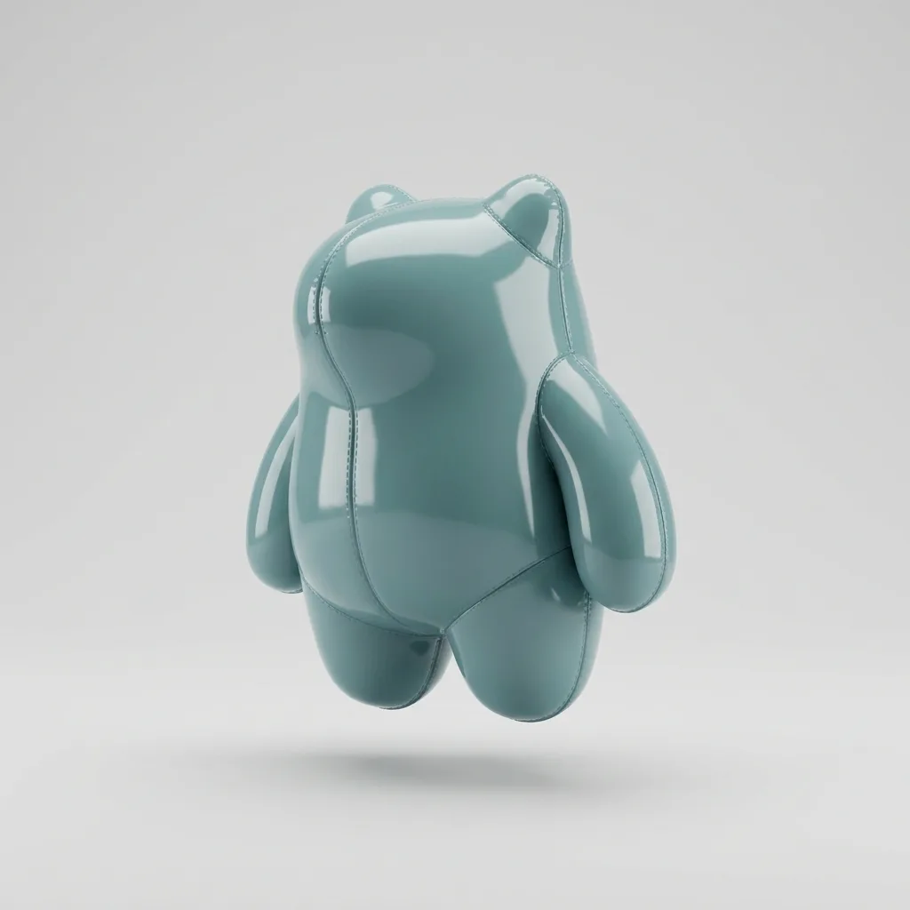

# SUBJECT , made of smooth inflated glossy vinyl plastic

[← Back to the collection](../../README.md) · Category: [Illustration & 3D](../../gallery/illustration-3d.md) · Model: `Vinano Image Pro` · ID: `vn-00912`

<a href="https://vinano.ai?utm_source=github&utm_medium=readme&utm_campaign=awesome-image-video-prompts-updating&utm_content=prompt-page-image"></a>

<sub>Preview generated with <a href="https://vinano.ai?utm_source=github&utm_medium=readme&utm_campaign=awesome-image-video-prompts-updating&utm_content=prompt-page-caption">vinano.ai</a></sub>

## Prompt

```text
[SUBJECT], made of smooth inflated glossy vinyl plastic, ultra-realistic 3D render, soft pillowy contours subtle stitched panel seams, slightly rounded toy-like proportions, highly polished surface strong specular highlights, realistic material depth, soft studio lighting creating gentle shadows and clean reflections, floating slightly above a plain light gray background, minimal composition, designer collectible aesthetic, premium art toy finish, high detail, centered composition, 1:1 aspect ratio. Aim for an editorial, design-driven look with deliberate negative space.
```

## Try it on vinano.ai

1. Copy the prompt above.
2. Open **[vinano.ai](https://vinano.ai?utm_source=github&utm_medium=readme&utm_campaign=awesome-image-video-prompts-updating&utm_content=prompt-page-try)**, paste it into the image generator and pick a model.
3. Swap any placeholders (brand, product, city, person…) for your own details, then generate.

More prompts like this: [Illustration & 3D gallery](../../gallery/illustration-3d.md) · [all categories](../../README.md#contents)
