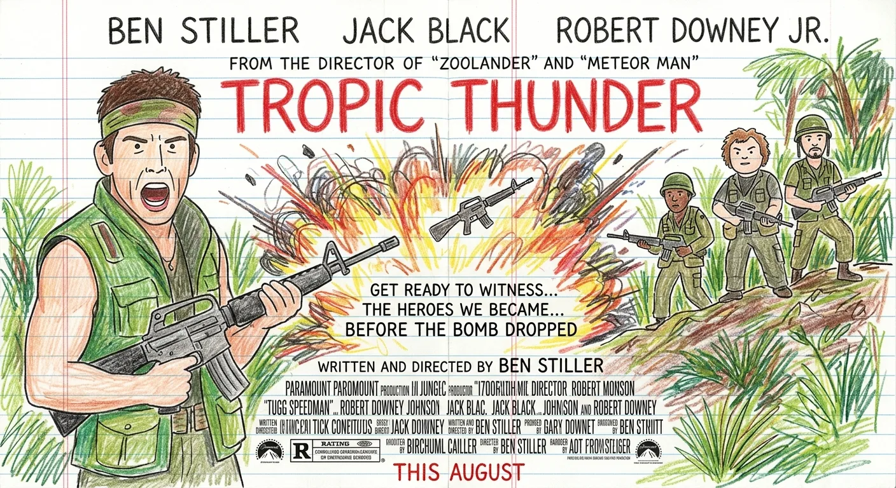

# Transform this movie poster into a child’s crayon drawing

[← Back to the collection](../../README.md) · Category: [Illustration & 3D](../../gallery/illustration-3d.md) · Model: `Vinano Image Pro` · ID: `vn-00913`

<a href="https://vinano.ai?utm_source=github&utm_medium=readme&utm_campaign=awesome-image-video-prompts-updating&utm_content=prompt-page-image"></a>

<sub>Preview generated with <a href="https://vinano.ai?utm_source=github&utm_medium=readme&utm_campaign=awesome-image-video-prompts-updating&utm_content=prompt-page-caption">vinano.ai</a></sub>

## Prompt

```text
Transform this movie poster into a child’s crayon drawing on lined notebook paper. Every compositional element, character pose, typography, color palette, and layout is preserved exactly as the original — only the art style has changed. Drawn in colored pencil and crayon wobbly unsteady lines, uneven coloring that goes slightly outside the lines, basic facial features, simplified anatomy. Background filled heavy crayon scribble strokes. Lined notebook paper visible underneath, including the red margin line. Text redrawn in shaky hand-lettered crayon matching the original font placement. Flat scan of the drawing, slight paper texture. Emphasise material texture and natural light so the final frame feels tactile and premium.
```

## Try it on vinano.ai

1. Copy the prompt above.
2. Open **[vinano.ai](https://vinano.ai?utm_source=github&utm_medium=readme&utm_campaign=awesome-image-video-prompts-updating&utm_content=prompt-page-try)**, paste it into the image generator and pick a model.
3. Swap any placeholders (brand, product, city, person…) for your own details, then generate.

More prompts like this: [Illustration & 3D gallery](../../gallery/illustration-3d.md) · [all categories](../../README.md#contents)
