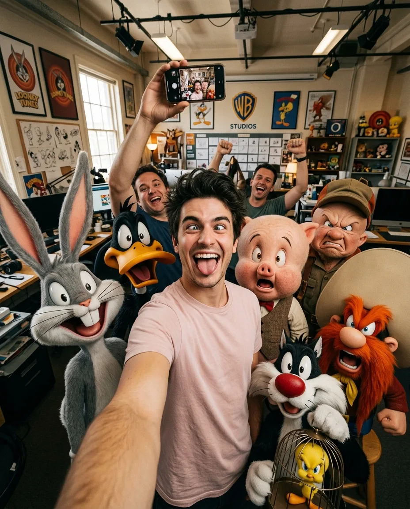

# 4:5 vertical format ultra wide angle 13mm selfie

[← Back to the collection](../../README.md) · Category: [Illustration & 3D](../../gallery/illustration-3d.md) · Model: `Vinano Image v2` · ID: `vn-00916`

<a href="https://vinano.ai?utm_source=github&utm_medium=readme&utm_campaign=awesome-image-video-prompts-updating&utm_content=prompt-page-image"></a>

<sub>Preview generated with <a href="https://vinano.ai?utm_source=github&utm_medium=readme&utm_campaign=awesome-image-video-prompts-updating&utm_content=prompt-page-caption">vinano.ai</a></sub>

## Prompt

```text
Ultra-realistic 4:5 vertical format ultra wide angle 13mm selfie of me Bugs Bunny, Daffy Duck, Porky Pig, Elmer Fudd, Yosemite Sam, Tweety, Sylvester in my studio. I am wearing pale pink t-shirt. We're all making silly, exaggerated faces. High camera angle. Extreme wide lense no fish-eye distortion. Realistic, live action characters no cartoon, filmic, cinematic lighting, all realistic characters integrated stylized realism. Preserve realistic proportions and depth for a confident, professional finish.
```

## Try it on vinano.ai

1. Copy the prompt above.
2. Open **[vinano.ai](https://vinano.ai?utm_source=github&utm_medium=readme&utm_campaign=awesome-image-video-prompts-updating&utm_content=prompt-page-try)**, paste it into the image generator and pick a model.
3. Swap any placeholders (brand, product, city, person…) for your own details, then generate.

More prompts like this: [Illustration & 3D gallery](../../gallery/illustration-3d.md) · [all categories](../../README.md#contents)
