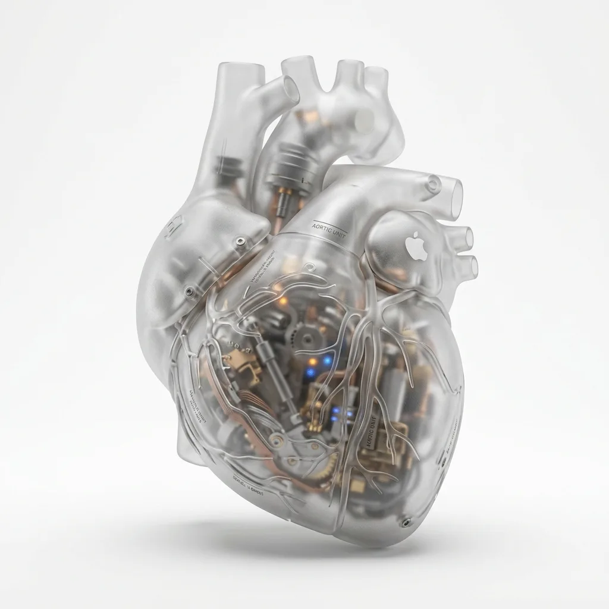

# 3D anatomical human organ made from semi-translucent frosted polycarbonate

[← Back to the collection](../../README.md) · Category: [Illustration & 3D](../../gallery/illustration-3d.md) · Model: `Vinano Image v2` · ID: `vn-00922`

<a href="https://vinano.ai?utm_source=github&utm_medium=readme&utm_campaign=awesome-image-video-prompts-updating&utm_content=prompt-page-image"></a>

<sub>Preview generated with <a href="https://vinano.ai?utm_source=github&utm_medium=readme&utm_campaign=awesome-image-video-prompts-updating&utm_content=prompt-page-caption">vinano.ai</a></sub>

## Prompt

```text
A hyper-realistic 3D anatomical human [organ] made from semi-translucent frosted polycarbonate a milky matte finish, softly diffusing light. Industrial injection-molded detailing, subtle micro-texture, and rounded edges precision seams. Inside, intricate mechanical components replace organic tissue, micro gears, pistons, circuitry, and engineered chambers visible but softly blurred through the shell. A subtle white Apple logo is naturally embedded on the surface, minimal and not overly obvious. Soft diffused studio lighting, realistic plastic refraction, subtle shadow beneath, centered composition, pure white background, ultra-detailed futuristic biomechanical render, 1:1 aspect ratio. Render with rich micro-detail while keeping the layout uncluttered and intentional.
```

## Try it on vinano.ai

1. Copy the prompt above.
2. Open **[vinano.ai](https://vinano.ai?utm_source=github&utm_medium=readme&utm_campaign=awesome-image-video-prompts-updating&utm_content=prompt-page-try)**, paste it into the image generator and pick a model.
3. Swap any placeholders (brand, product, city, person…) for your own details, then generate.

More prompts like this: [Illustration & 3D gallery](../../gallery/illustration-3d.md) · [all categories](../../README.md#contents)
