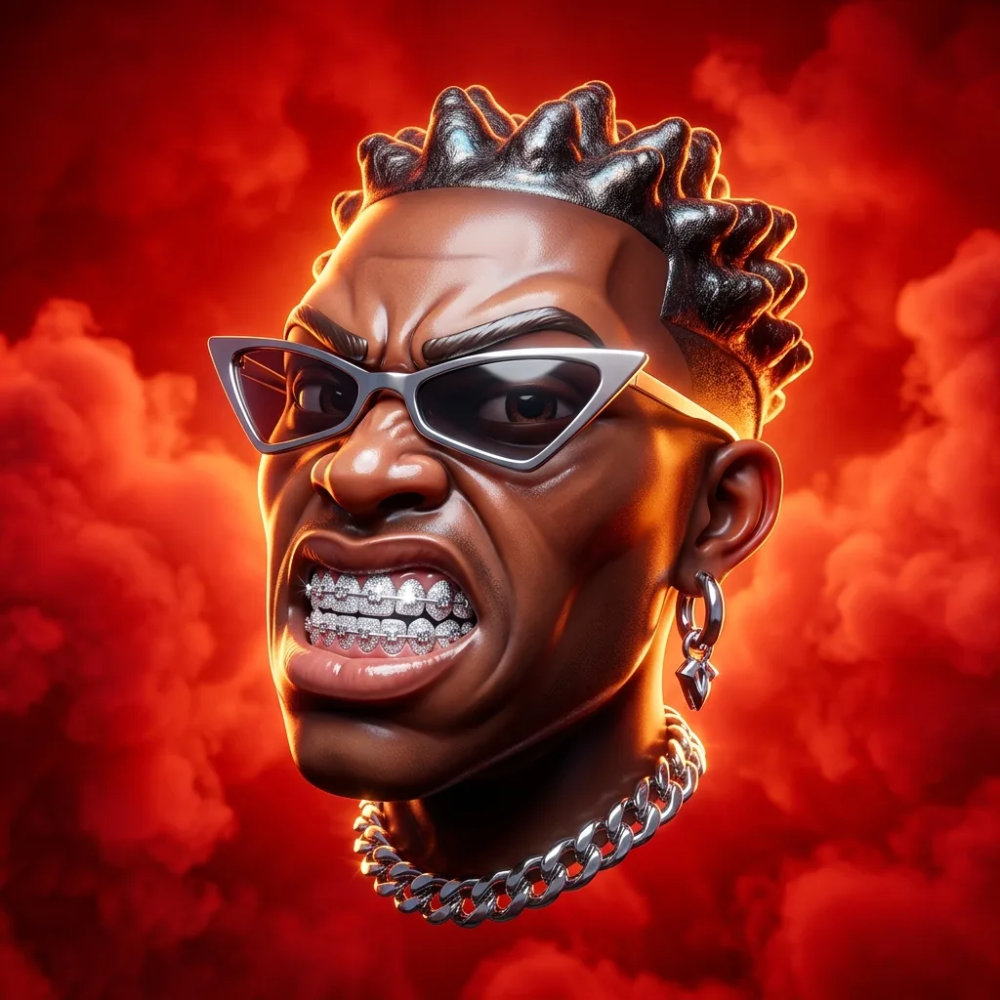

# Hyper-stylized, dynamic 3D head portrait floats against a vivid

[← Back to the collection](../../README.md) · Category: [Illustration & 3D](../../gallery/illustration-3d.md) · Model: `Vinano Image v2` · ID: `vn-00937`

<a href="https://vinano.ai?utm_source=github&utm_medium=readme&utm_campaign=awesome-image-video-prompts-updating&utm_content=prompt-page-image"></a>

<sub>Preview generated with <a href="https://vinano.ai?utm_source=github&utm_medium=readme&utm_campaign=awesome-image-video-prompts-updating&utm_content=prompt-page-caption">vinano.ai</a></sub>

## Prompt

```text
A hyper-stylized, dynamic 3D head portrait floats against a vivid red background soft volumetric clouds and seamless shading. Only the cartoonish 3D head appears, no neck visible, and facial features closely matching the reference photo. The head is tilted and fills approximately 80% of the frame. The character displays a fierce, aggressive expression a wide snarl, revealing teeth adorned diamond-studded braces. Sharp, angular silver sunglasses pointed frames fit the face precisely. Additional accessories include chrome earrings and a chunky silver chain necklace. Lighting is bold and metallic, combining strong rim lights from above and behind a luminous frontal fill that sculpts facial contours and creates glossy skin highlights. The overall look features over-the-top glossy realism, exaggerated proportions, intense reflections, and a futuristic, high-energy aesthetic partial overlap of elements to enhance depth and dramatic presence. Hyper-detailed 3D forms add vibrant, cinematic intensity and visual impact. Aspect ratio 4:5 Keep edges clean and the overall composition balanced for a polished, gallery-ready result.
```

## Try it on vinano.ai

1. Copy the prompt above.
2. Open **[vinano.ai](https://vinano.ai?utm_source=github&utm_medium=readme&utm_campaign=awesome-image-video-prompts-updating&utm_content=prompt-page-try)**, paste it into the image generator and pick a model.
3. Swap any placeholders (brand, product, city, person…) for your own details, then generate.

More prompts like this: [Illustration & 3D gallery](../../gallery/illustration-3d.md) · [all categories](../../README.md#contents)
