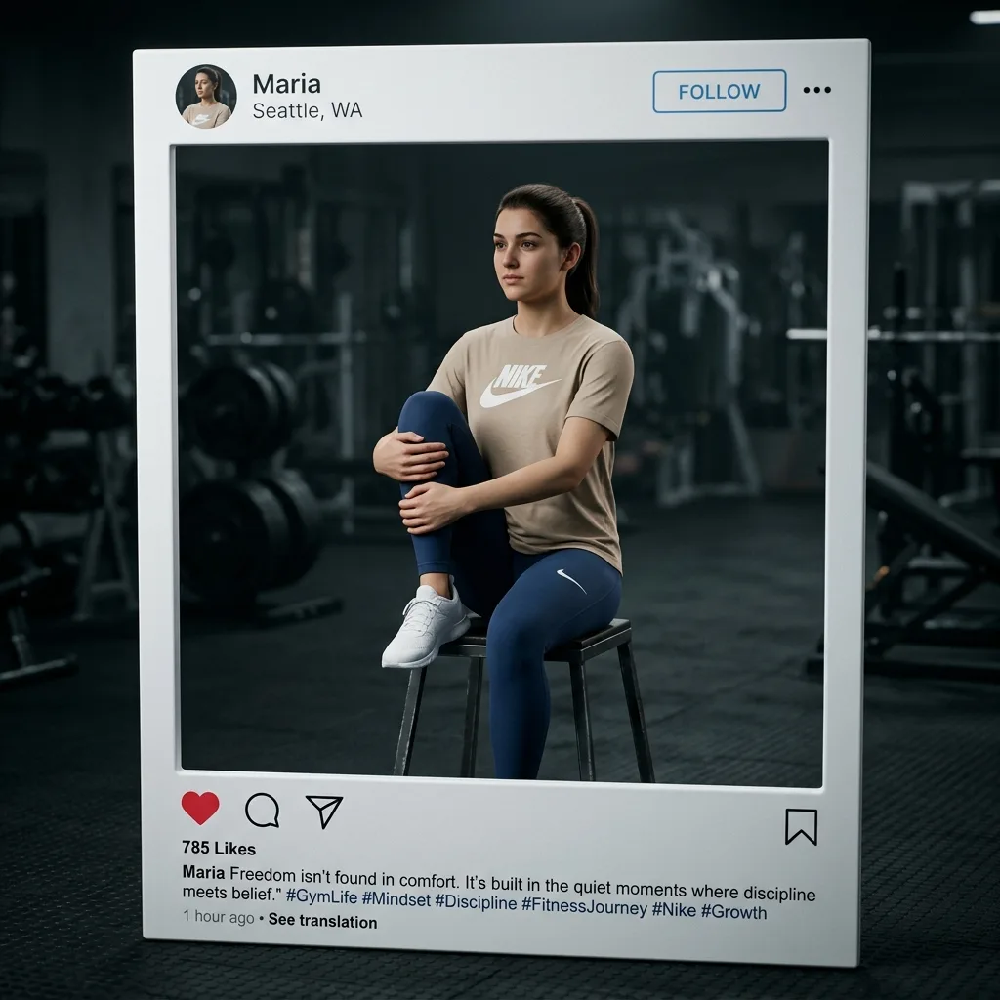

# True-to-life photorealistic young woman brown hair tied back

[← Back to the collection](../../README.md) · Category: [Illustration & 3D](../../gallery/illustration-3d.md) · Model: `Vinano Image v2` · ID: `vn-00950`

<a href="https://vinano.ai?utm_source=github&utm_medium=readme&utm_campaign=awesome-image-video-prompts-updating&utm_content=prompt-page-image"></a>

<sub>Preview generated with <a href="https://vinano.ai?utm_source=github&utm_medium=readme&utm_campaign=awesome-image-video-prompts-updating&utm_content=prompt-page-caption">vinano.ai</a></sub>

## Prompt

```text
{
 "image_generation_prompt": {
 "subject": {
 "description": "A true-to-life photorealistic young woman brown hair tied back in a ponytail, sitting on a stool.",
 "pose": "Sitting one knee raised, hands clasped around her shin, looking slightly to the side a calm, focused expression.",
 "clothing": {
 "top": "Beige t-shirt a white Nike swoosh logo on the chest.",
 "bottoms": "Dark blue leggings a small white swoosh logo on the thigh.",
 "footwear": "White athletic sneakers."
 }
 },
 "composition": {
 "foreground_element": "A large, 3D-rendered white social media frame resembling an Instagram post, physically framing the subject.",
 "ui_details": {
 "header": {
 "profile_picture": "Profile picture of the woman",
 "username": "Maria",
 "follow_button": {
 "text": "FOLLOW",
 "color": "Blue"
 }
 },
 "footer_icons": [{
 "type": "like",
 "icon": "Heart",
 "color": "Red",
 "state": "Liked"
 },
 {
 "type": "comment",
 "icon": "Comment bubble"
 },
 {
 "type": "share",
 "icon": "Paper plane"
 },
 {
 "type": "bookmark",
 "icon": "Bookmark"
 }],
 "likes_count": 785,
 "caption": "Freedom isn’t found in comfort. It’s built in the quiet moments where discipline meets belief."
 }
 },
 "environment": {
 "setting": "A dimly lit, atmospheric gym background.",
 "details": "Blurred gym equipment in the shadows, creating a strong depth of field."
 },
 "style": {
 "visual_style": "3D realistic render Unreal Engine 5, cinematic and high fidelity.",
 "lighting": {
 "subject": "Soft spotlight focused on the woman",
 "background": "Cool ambient lighting subtle shadows"
 }
 }
 }
}

Render with rich micro-detail while keeping the layout uncluttered and intentional.
```

## Try it on vinano.ai

1. Copy the prompt above.
2. Open **[vinano.ai](https://vinano.ai?utm_source=github&utm_medium=readme&utm_campaign=awesome-image-video-prompts-updating&utm_content=prompt-page-try)**, paste it into the image generator and pick a model.
3. Swap any placeholders (brand, product, city, person…) for your own details, then generate.

More prompts like this: [Illustration & 3D gallery](../../gallery/illustration-3d.md) · [all categories](../../README.md#contents)
