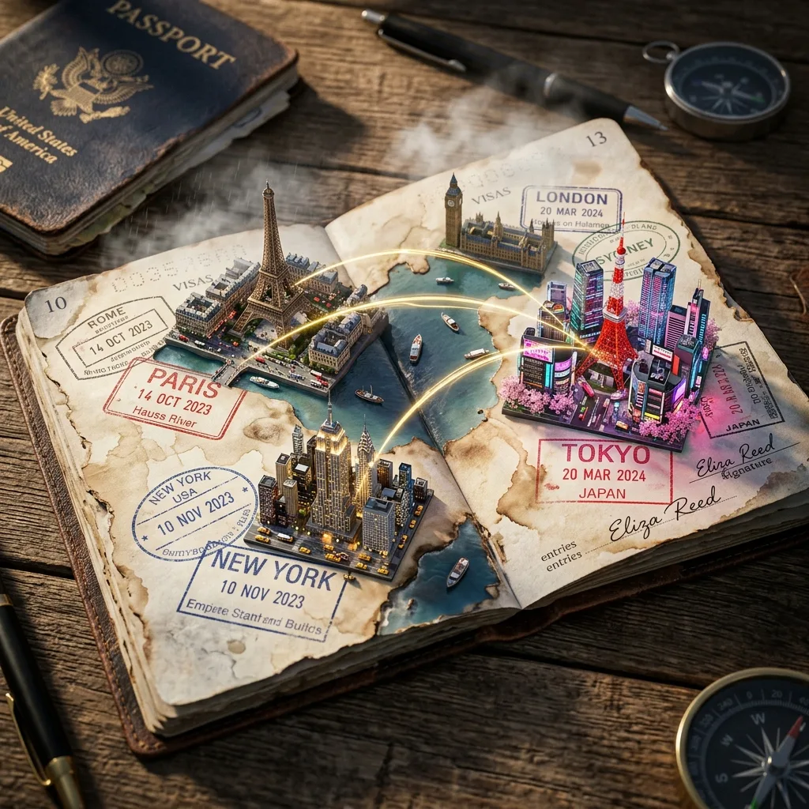

# Epic 3D scene

[← Back to the collection](../../README.md) · Category: [Illustration & 3D](../../gallery/illustration-3d.md) · Model: `Vinano Image v2` · ID: `vn-01003`

<a href="https://vinano.ai?utm_source=github&utm_medium=readme&utm_campaign=awesome-image-video-prompts-updating&utm_content=prompt-page-image"></a>

<sub>Preview generated with <a href="https://vinano.ai?utm_source=github&utm_medium=readme&utm_campaign=awesome-image-video-prompts-updating&utm_content=prompt-page-caption">vinano.ai</a></sub>

## Prompt

```text
Epic 3D scene: a weathered passport lies open, its visa stamps erupting into the destinations they represent. Each ink impression becomes a portal—[CITY 1] rises in miniature from one stamp [DETAIL 1], [CITY 2] pushes through another [DETAIL 2], [CITY 3] manifests [DETAIL 3]. [LANDMARK 1], [LANDMARK 2], and [LANDMARK 3] stand at different scales across the pages. Flight paths arc overhead as glowing golden trajectories weaving between all the worlds.
Coffee stains become lakes. Worn edges erode into coastlines. [ATMOSPHERIC ELEMENT 1] drifts from one destination while [ATMOSPHERIC ELEMENT 2] swirls near another.
Dramatic raking light, tilt-shift depth of field, 8K, UE5, filmic, cinematic lighting. The bureaucratic document transformed into a living archive of adventures.

Keep edges clean and the overall composition balanced for a polished, gallery-ready result.
```

## Try it on vinano.ai

1. Copy the prompt above.
2. Open **[vinano.ai](https://vinano.ai?utm_source=github&utm_medium=readme&utm_campaign=awesome-image-video-prompts-updating&utm_content=prompt-page-try)**, paste it into the image generator and pick a model.
3. Swap any placeholders (brand, product, city, person…) for your own details, then generate.

More prompts like this: [Illustration & 3D gallery](../../gallery/illustration-3d.md) · [all categories](../../README.md#contents)
