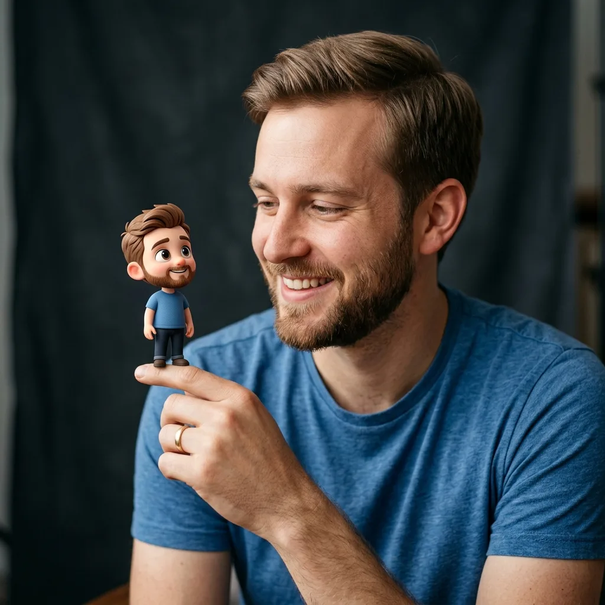

# Close-up studio portrait

[← Back to the collection](../../README.md) · Category: [Illustration & 3D](../../gallery/illustration-3d.md) · Model: `Vinano Image v2` · ID: `vn-01020`

<a href="https://vinano.ai?utm_source=github&utm_medium=readme&utm_campaign=awesome-image-video-prompts-updating&utm_content=prompt-page-image"></a>

<sub>Preview generated with <a href="https://vinano.ai?utm_source=github&utm_medium=readme&utm_campaign=awesome-image-video-prompts-updating&utm_content=prompt-page-caption">vinano.ai</a></sub>

## Prompt

```text
{
 "Objective": "Create a hyper-realistic studio portrait blending photorealism a whimsical 3D cartoon miniature character",
 "PersonaDetails": {
 "PrimarySubject": {
 "Type": "Young man",
 "Appearance": {
 "Hair": "Light brown hair, neatly styled",
 "FacialHair": "Neatly trimmed beard",
 "Skin": "true-to-life photorealistic, natural texture"
 },
 "Expression": "Soft, warm smile",
 "Gaze": "Looking at the miniature character on his fingertips",
 "Wardrobe": "Blue t-shirt"
 },
 "SecondarySubject": {
 "Type": "Tiny 3D cartoon version of the man",
 "Scale": "Miniature, resting on fingertips",
 "Style": "Pixar-style 3D character design",
 "Proportions": "Exaggerated cute proportions",
 "Features": {
 "Eyes": "Large, expressive",
 "Expression": "Friendly, playful pose"
 },
 "Consistency": "Matching hairstyle and outfit of the main subject"
 }
 },
 "Composition": {
 "Framing": "Close-up studio portrait",
 "Focus": "Ultra-sharp focus on both faces",
 "DepthOfField": "Shallow depth of field soft background blur",
 "Balance": "Clean, centered composition emphasizing interaction"
 },
 "LightingAndMood": {
 "LightingStyle": "Cinematic soft studio lighting",
 "Highlights": "Gentle highlights on skin and miniature character",
 "Background": "Dark neutral backdrop",
 "Mood": "Modern, whimsical, warm"
 },
 "ArtDirection": {
 "StyleFusion": ["true-to-life photorealistic human portrait",
 "Pixar-style 3D character rendering"],
 "DetailLevel": "High detail clean textures",
 "RealismBalance": "Realistic human combined stylized miniature"
 },
 "PhotographyStyle": {
 "Genre": "Professional studio portrait photography",
 "LensLook": "85mm lens perspective",
 "ImageQuality": "High resolution, ultra-sharp clarity"
 },
 "ColorAndTone": {
 "ColorPalette": "Natural skin tones soft, modern colors",
 "Contrast": "Balanced contrast, smooth tonal transitions"
 },
 "NegativePrompt": ["cartoon human",
 "uncanny valley",
 "harsh lighting",
 "oversaturated colors",
 "blurry faces",
 "low detail",
 "messy composition"],
 "ResponseFormat": {
 "Type": "Single image",
 "Orientation": "Portrait",
 "AspectRatio": "2:3"
 }
}

Emphasise material texture and natural light so the final frame feels tactile and premium.
```

## Try it on vinano.ai

1. Copy the prompt above.
2. Open **[vinano.ai](https://vinano.ai?utm_source=github&utm_medium=readme&utm_campaign=awesome-image-video-prompts-updating&utm_content=prompt-page-try)**, paste it into the image generator and pick a model.
3. Swap any placeholders (brand, product, city, person…) for your own details, then generate.

More prompts like this: [Illustration & 3D gallery](../../gallery/illustration-3d.md) · [all categories](../../README.md#contents)
