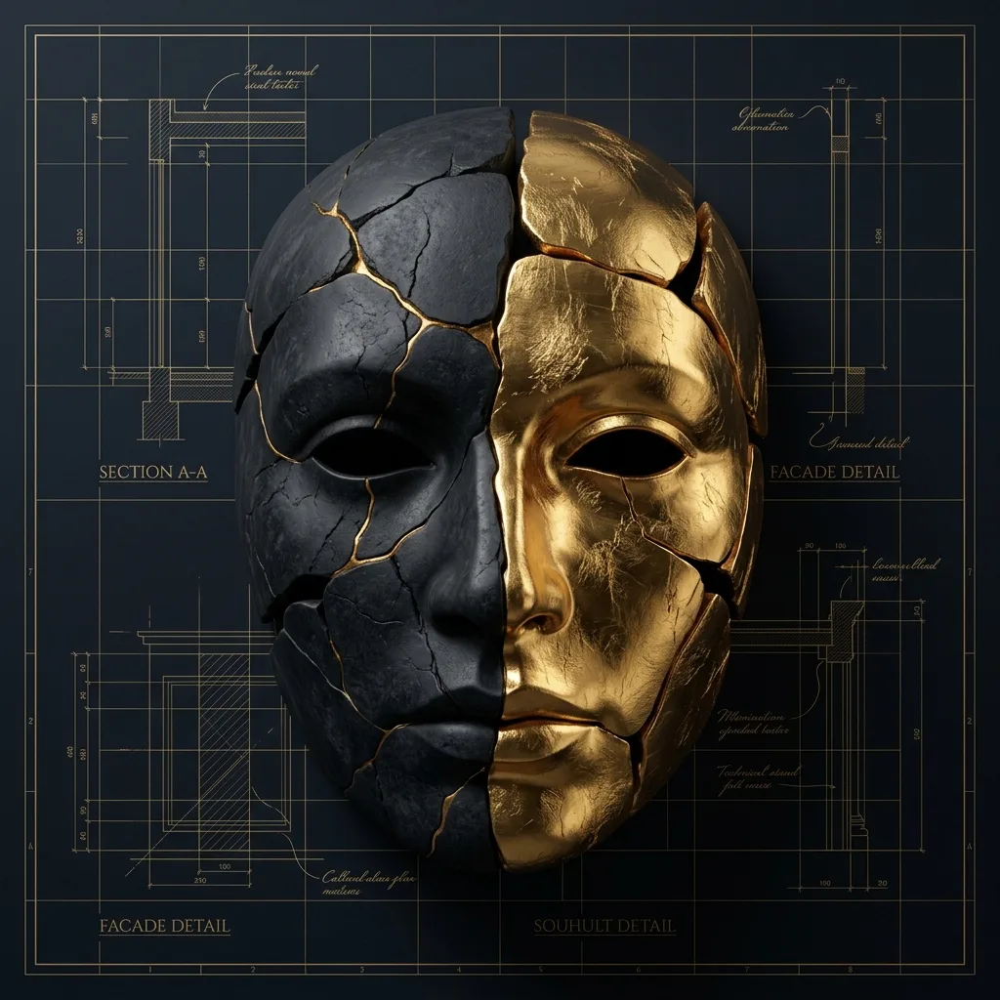

# High-detail artistic 3D portrait of the person

[← Back to the collection](../../README.md) · Category: [Illustration & 3D](../../gallery/illustration-3d.md) · Model: `Vinano Image Pro` · ID: `vn-01023`

<a href="https://vinano.ai?utm_source=github&utm_medium=readme&utm_campaign=awesome-image-video-prompts-updating&utm_content=prompt-page-image"></a>

<sub>Preview generated with <a href="https://vinano.ai?utm_source=github&utm_medium=readme&utm_campaign=awesome-image-video-prompts-updating&utm_content=prompt-page-caption">vinano.ai</a></sub>

## Prompt

```text
A high-detail artistic 3D portrait of the person in the photo, reimagined as a fragmented sculptural mask. The face is vertically split: one side is made of matte charcoal-black stone deep cracks, while the other side is polished, radiant leaf gold. The entire composition is overlaid on a dark architectural blueprint background featuring intricate gold grid lines, technical diagrams, and elegant golden serif typography. filmic, cinematic lighting, hyper-realistic textures, Kintsugi-inspired aesthetic, luxury conceptual art, 8k resolution, moody and sophisticated atmosphere. Maintain consistent colour harmony and crisp focus across the whole frame.
```

## Try it on vinano.ai

1. Copy the prompt above.
2. Open **[vinano.ai](https://vinano.ai?utm_source=github&utm_medium=readme&utm_campaign=awesome-image-video-prompts-updating&utm_content=prompt-page-try)**, paste it into the image generator and pick a model.
3. Swap any placeholders (brand, product, city, person…) for your own details, then generate.

More prompts like this: [Illustration & 3D gallery](../../gallery/illustration-3d.md) · [all categories](../../README.md#contents)
