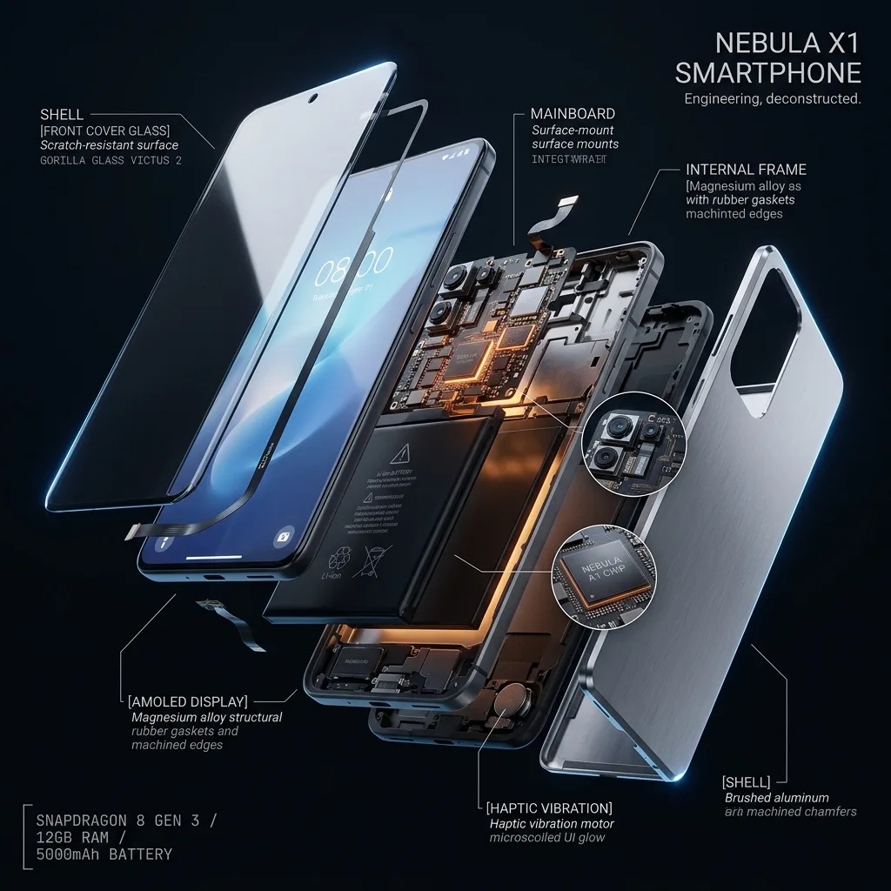

# Hyperrealistic 3D radial exploded view of PRODUCT NUMBER components

[← Back to the collection](../../README.md) · Category: [Illustration & 3D](../../gallery/illustration-3d.md) · Model: `Vinano Image Pro` · ID: `vn-01027`

<a href="https://vinano.ai?utm_source=github&utm_medium=readme&utm_campaign=awesome-image-video-prompts-updating&utm_content=prompt-page-image"></a>

<sub>Preview generated with <a href="https://vinano.ai?utm_source=github&utm_medium=readme&utm_campaign=awesome-image-video-prompts-updating&utm_content=prompt-page-caption">vinano.ai</a></sub>

## Prompt

```text
Hyperrealistic 3D radial exploded view of [PRODUCT] [NUMBER] components bursting outward from a central axis in every direction, frozen in mid-air. True spatial explosion, not a vertical stack, depth and parallax visible. COMPONENTS (core outward): [SHELL] → [DISPLAY] → [FRAME] → [MAINBOARD] → [BATTERY] → [MICRO PARTS shown in 3x floating callout circles] MATERIALS: glass refracts and catches specular highlights, aluminium shows brushed grain and machined edges, PCB traces glow faintly amber, rubber gaskets matte micro-texture, cables soft bend physics. LABELS: hairline leader to floating box. "[COMPONENT]" uppercase / "[FUNCTION]" italic / "[KEY SPEC]" monospace. Radiate outward, no overlaps. LIGHTING: cool diffused overhead + warm amber underlighting on internals + thin blue rim on outer shell. Displays emit soft UI glow. Circuits self-illuminate. BACKGROUND: [COLOR], deep, non-reflective. Midnight black recommended. TITLE: "[PRODUCT NAME]" top right. SUBTITLE: "[TAGLINE]". SPEC BLOCK: "[SPEC 1] / [SPEC 2] / [SPEC 3]" bottom left in monospace. Mood: iFixit teardown meets NASA manual meets WIRED cover. 4K, tack sharp, extraordinary material fidelity. Maintain consistent colour harmony and crisp focus across the whole frame.
```

## Try it on vinano.ai

1. Copy the prompt above.
2. Open **[vinano.ai](https://vinano.ai?utm_source=github&utm_medium=readme&utm_campaign=awesome-image-video-prompts-updating&utm_content=prompt-page-try)**, paste it into the image generator and pick a model.
3. Swap any placeholders (brand, product, city, person…) for your own details, then generate.

More prompts like this: [Illustration & 3D gallery](../../gallery/illustration-3d.md) · [all categories](../../README.md#contents)
