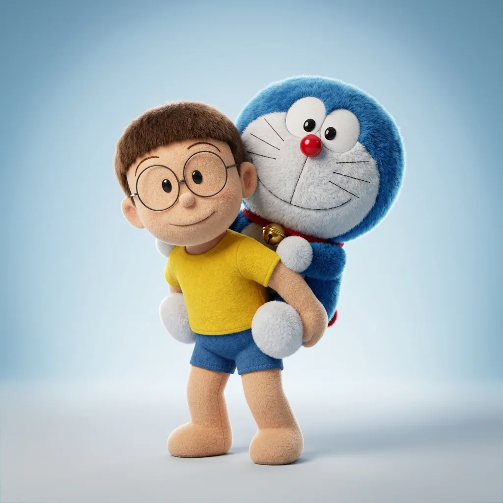

# Ultra-detailed 3D plush cartoon character, inspired by classic animated

[← Back to the collection](../../README.md) · Category: [Illustration & 3D](../../gallery/illustration-3d.md) · Model: `Vinano Image v2` · ID: `vn-01043`

<a href="https://vinano.ai?utm_source=github&utm_medium=readme&utm_campaign=awesome-image-video-prompts-updating&utm_content=prompt-page-image"></a>

<sub>Preview generated with <a href="https://vinano.ai?utm_source=github&utm_medium=readme&utm_campaign=awesome-image-video-prompts-updating&utm_content=prompt-page-caption">vinano.ai</a></sub>

## Prompt

```text
Ultra-detailed 3D plush cartoon character, inspired by classic animated TV style, standing in center frame, full body visible. Character designed as a soft toy realistic fluffy fur texture, smooth rounded shapes, vibrant saturated colors, big expressive eyes, cute proportions, the image of [Doraemon's] character, [Nobita carries Doraemon on his back].

High-resolution Pixar-style 3D rendering, soft studio lighting, subtle rim light, clean gradient background (blue tone), filmic, cinematic lighting, depth of field, highly detailed fur strands, soft shadows under feet, glossy nose, toy-like material, ultra sharp 8K render.

Centered composition, minimal background, character facing camera, symmetrical pose, adorable expression.

Keep edges clean and the overall composition balanced for a polished, gallery-ready result.
```

## Try it on vinano.ai

1. Copy the prompt above.
2. Open **[vinano.ai](https://vinano.ai?utm_source=github&utm_medium=readme&utm_campaign=awesome-image-video-prompts-updating&utm_content=prompt-page-try)**, paste it into the image generator and pick a model.
3. Swap any placeholders (brand, product, city, person…) for your own details, then generate.

More prompts like this: [Illustration & 3D gallery](../../gallery/illustration-3d.md) · [all categories](../../README.md#contents)
