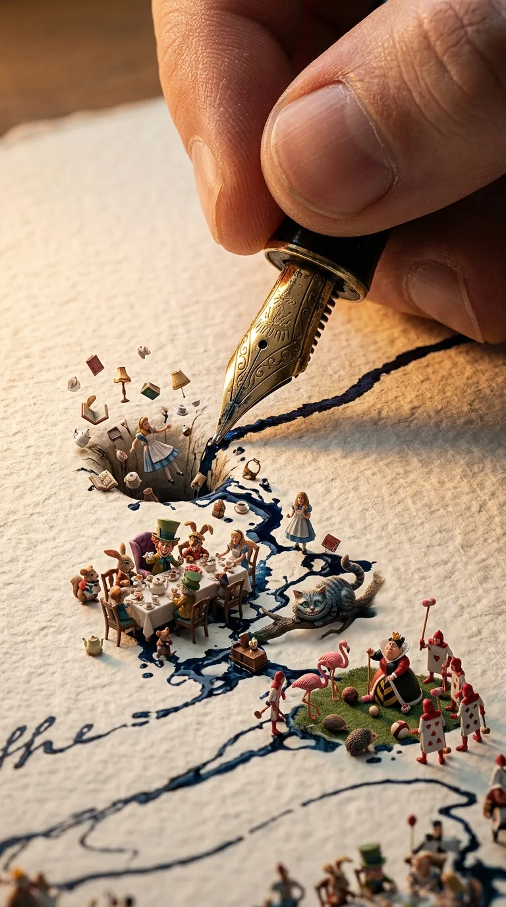

# Colossal hand gripping an enormous vintage fountain pen, captured

[← Back to the collection](../../README.md) · Category: [Illustration & 3D](../../gallery/illustration-3d.md) · Model: `Vinano Image v2` · ID: `vn-01089`

<a href="https://vinano.ai?utm_source=github&utm_medium=readme&utm_campaign=awesome-image-video-prompts-updating&utm_content=prompt-page-image"></a>

<sub>Preview generated with <a href="https://vinano.ai?utm_source=github&utm_medium=readme&utm_campaign=awesome-image-video-prompts-updating&utm_content=prompt-page-caption">vinano.ai</a></sub>

## Prompt

```text
A colossal hand gripping an enormous vintage fountain pen, captured in vertical portrait format (9:16), writing on endless textured paper that fills the frame. Where the ink flows, the story of [BOOK_NAME] bursts into vivid life — [iconic characters, key objects, and signature scenes from [BOOK_NAME] emerging as tiny miniature figures on the paper, each no larger than a fingernail, ultra-miniature scale]. The miniature world cascades downward across the page as the pen moves, characters frozen mid-story, ink still wet at the edges where they emerge. Extreme close-up of the enormous pen nib touching paper, ink bleeding into fiber, fingertips visible skin texture. Warm amber and soft golden light raking across the paper surface, deep shadows, cinematic depth of field, magical realism, hyper-detailed, true-to-life photorealistic, 8K, --ar 9:16 Emphasise material texture and natural light so the final frame feels tactile and premium.
```

## Try it on vinano.ai

1. Copy the prompt above.
2. Open **[vinano.ai](https://vinano.ai?utm_source=github&utm_medium=readme&utm_campaign=awesome-image-video-prompts-updating&utm_content=prompt-page-try)**, paste it into the image generator and pick a model.
3. Swap any placeholders (brand, product, city, person…) for your own details, then generate.

More prompts like this: [Illustration & 3D gallery](../../gallery/illustration-3d.md) · [all categories](../../README.md#contents)
