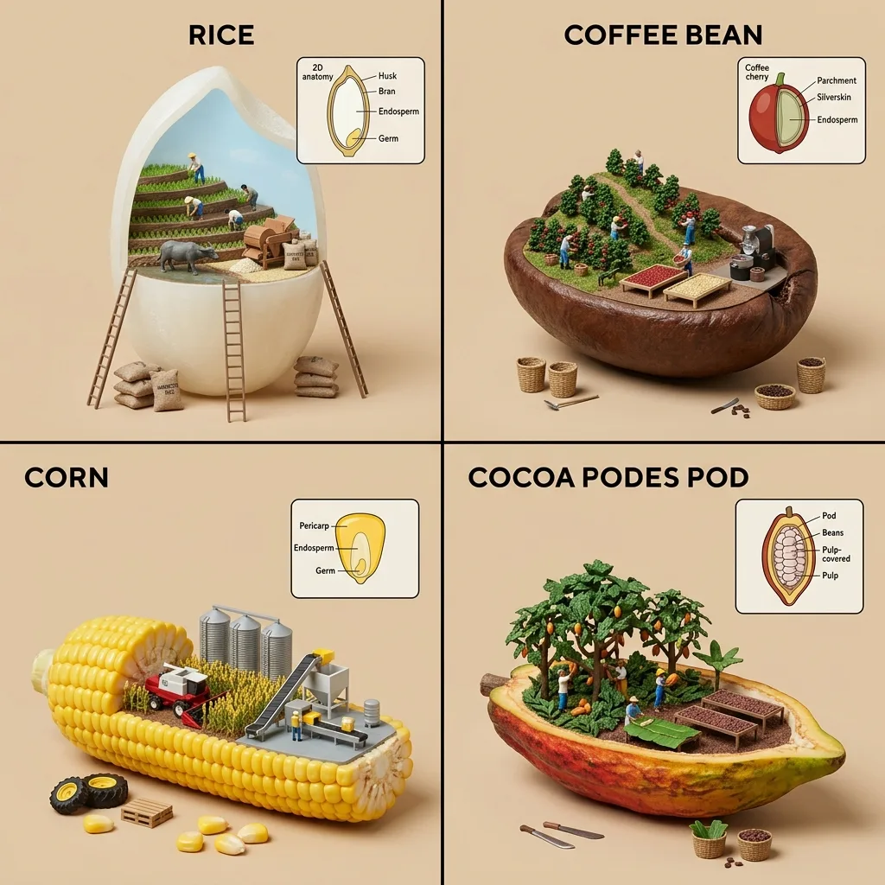

# Illustration & 3D prompt #1154

[← Back to the collection](../../README.md) · Category: [Illustration & 3D](../../gallery/illustration-3d.md) · Model: `Vinano Image Pro` · ID: `vn-01154`

<a href="https://vinano.ai?utm_source=github&utm_medium=readme&utm_campaign=awesome-image-video-prompts-updating&utm_content=prompt-page-image"></a>

<sub>Preview generated with <a href="https://vinano.ai?utm_source=github&utm_medium=readme&utm_campaign=awesome-image-video-prompts-updating&utm_content=prompt-page-caption">vinano.ai</a></sub>

## Prompt

```text
2x2 grid, do this for 4 common ingredients (like rice, diamond): render_target = (giant_sliced_open_[product_name] * 2.0) + (inferred_harvesting_and_processing_diorama_inside * 1.8) + (miniature_1:87_scale_plastic_workers * 1.5) + (floating_2d_anatomy_diagram_box_top_right * 2.0) + (tiny_ladders_and_sacks_exterior * 1.0) + (clean_beige_studio_background * 1.2) - (life_size_humans / 2.0) - (cluttered_background / 2.0) - (3d_rendered_ui_box) Preserve realistic proportions and depth for a confident, professional finish.
```

## Try it on vinano.ai

1. Copy the prompt above.
2. Open **[vinano.ai](https://vinano.ai?utm_source=github&utm_medium=readme&utm_campaign=awesome-image-video-prompts-updating&utm_content=prompt-page-try)**, paste it into the image generator and pick a model.
3. Swap any placeholders (brand, product, city, person…) for your own details, then generate.

More prompts like this: [Illustration & 3D gallery](../../gallery/illustration-3d.md) · [all categories](../../README.md#contents)
