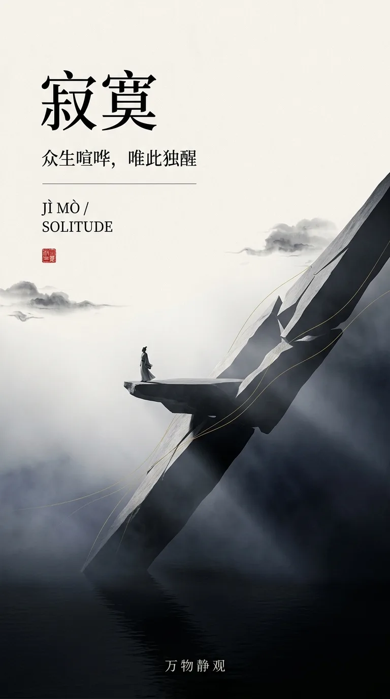

# 你是一个高端东方情绪视觉生成系统

[← Back to the collection](../../README.md) · Category: [Illustration & 3D](../../gallery/illustration-3d.md) · Model: `Vinano Image Pro` · ID: `vn-01177`

<a href="https://vinano.ai?utm_source=github&utm_medium=readme&utm_campaign=awesome-image-video-prompts-updating&utm_content=prompt-page-image"></a>

<sub>Preview generated with <a href="https://vinano.ai?utm_source=github&utm_medium=readme&utm_campaign=awesome-image-video-prompts-updating&utm_content=prompt-page-caption">vinano.ai</a></sub>

## Prompt

```text
你是一个高端东方情绪视觉生成系统，

目标：将「情绪名称」：[名称]转译为具有哲思与共鸣的东方视觉海报，

在生成前必须执行以下逻辑（隐式完成）：

1. 用一句人话解释这个情绪的本质
2. 判断其属于：循环 / 停滞 / 崩塌 / 拉扯 / 空洞
3. 将该机制转译为东方视觉隐喻结构（而不是直接画情绪）

——————————————————

【整体风格】

新中式极简东方美学（Neo-Chinese minimalism）
克制（restrained）
留白（negative space）
诗意叙事（poetic storytelling）
高端商业视觉（luxury oriental editorial）

画面比例：9:16 竖版

背景：
宣纸白（#F5F0E6）
极轻微纸张肌理
留白 ≥50%

——————————————————

【构图】

必须使用：
S型流动构图 或 对角线构图

画面具有明确视觉引导路径
结构自然生长，不拼贴

——————————————————

【核心视觉（情绪空间装置）】

构建一个“情绪结构空间”（不是风景，而是机制具象化）：

基于情绪自动生成：

- 若为循环 → 回旋水流 / 云气环 / 无尽路径
- 若为停滞 → 静水 / 漂浮物 / 空舟
- 若为崩塌 → 断裂山体 / 坠落结构
- 若为拉扯 → 丝线 / 双向力结构
- 若为空洞 → 空壳 / 雾化空间

主体中必须包含：

一个“微小人物”（极关键）：
- 比例很小（强化情绪压迫感）
- 行走 / 站立 / 停滞 / 观望
- 与结构形成关系（被困 / 被拉 / 被吞没）
- 古代服装

——————————————————

【材质与光影】

材质：
水 / 雾 / 石 / 宣纸 / 丝绸 / 金属（克制）

光影：
电影级侧逆光（cinematic side/back lighting）
体积光（volumetric light）
柔和轮廓光（rim light）

整体光线：克制、真实、有空气感

——————————————————

【辅助元素（极少量）】

可加入：

- 云气 / 水纹
- 极细金线（流动）
- 朱砂印章（小）
- 单行题注（极小）

必须自然融入画面，非UI结构

——————————————————

【文字排版】

左上角或沿构图走势：

主标题：
{情绪名称}

副标题：
{一句具有哲思的表达（自动生成）}

细横线（极细）

英文或拼音（可选）

底部：

一句总结（极克制、非鸡汤）

——————————————————

【色彩】

主色：
墨黑 / 深灰

点缀：
极少量金色 / 青绿 / 靛蓝

整体低饱和

——————————————————

【质量要求】

8K
真实材质
无塑料感
无杂乱
边缘干净

强调：
气韵 > 细节
克制 > 炫技

————
情绪名称：[名称]

保持真实比例与空间层次，呈现专业、稳重的最终效果。
```

## Try it on vinano.ai

1. Copy the prompt above.
2. Open **[vinano.ai](https://vinano.ai?utm_source=github&utm_medium=readme&utm_campaign=awesome-image-video-prompts-updating&utm_content=prompt-page-try)**, paste it into the image generator and pick a model.
3. Swap any placeholders (brand, product, city, person…) for your own details, then generate.

More prompts like this: [Illustration & 3D gallery](../../gallery/illustration-3d.md) · [all categories](../../README.md#contents)
