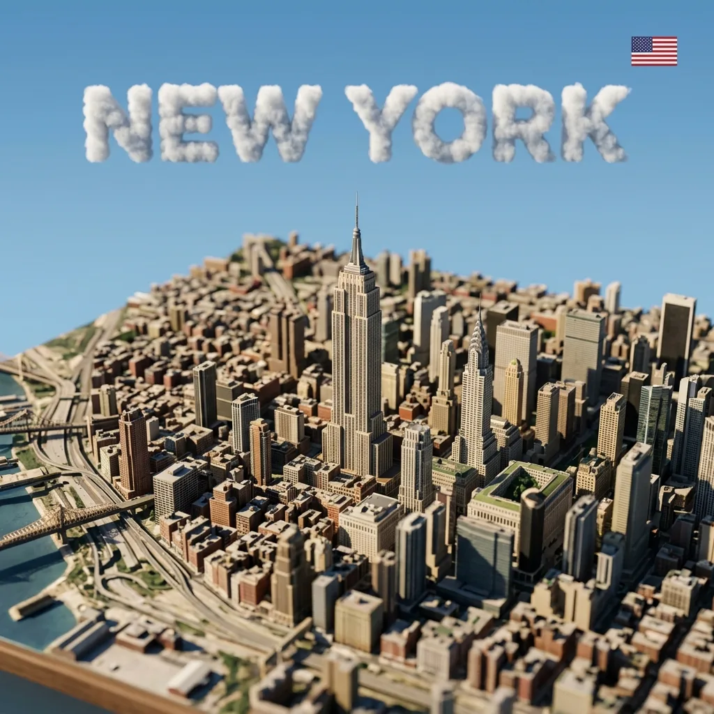

# Square, 1:1 true-to-life photorealistic close-up photograph of an incredibly

[← Back to the collection](../../README.md) · Category: [Illustration & 3D](../../gallery/illustration-3d.md) · Model: `Vinano Image Pro` · ID: `vn-01180`

<a href="https://vinano.ai?utm_source=github&utm_medium=readme&utm_campaign=awesome-image-video-prompts-updating&utm_content=prompt-page-image"></a>

<sub>Preview generated with <a href="https://vinano.ai?utm_source=github&utm_medium=readme&utm_campaign=awesome-image-video-prompts-updating&utm_content=prompt-page-caption">vinano.ai</a></sub>

## Prompt

```text
A square, 1:1 true-to-life photorealistic close-up photograph of an incredibly detailed physical miniature geography and city model of [CITY], focused only on the city’s most recognizable landmark area (not the full city map).

The scene shows a compact 3D topographic environment built around the iconic landmark zone — realistic terrain, elevation changes, nearby rivers or coastline if relevant, and surrounding urban density scaled naturally to highlight the landmark as the clear focal point. The model feels like a premium museum diorama rather than a map.

Thousands of tiny, highly detailed buildings, roads, bridges, and infrastructure cluster organically around the landmark. The landmark itself rises prominently above everything else, instantly recognizable even at a glance.

Strong natural side sunlight casts long, realistic shadows across the miniature terrain, enhancing depth and realism. Shallow depth of field (tilt-shift style) keeps the landmark zone sharply in focus while softly blurring the outer edges of the square frame. The entire scene appears as a tangible, physical model illuminated by real-world light.

Above the city, the sky is perfectly clean and empty — no clouds at all — except for the city name.

The name [CITY] appears integrated into the sky as thick, three-dimensional cloud typography, sculpted from dense white vapor. The letters are bold, volumetric, and clearly readable, soft shadowing and subtle depth, floating naturally in the open sky. Opacity ~70%, but enough thickness to remain instantly legible.

A small, minimal national flag is placed subtly near the sky text (corner or aligned to the typography), balanced and unobtrusive.

Format: Square 1080×1080
Style: Ultra-true-to-life photorealistic, cinematic, premium miniature realism
Mood: Awe, clarity, instantly recognizable, highly shareable

Maintain consistent colour harmony and crisp focus across the whole frame.
```

## Try it on vinano.ai

1. Copy the prompt above.
2. Open **[vinano.ai](https://vinano.ai?utm_source=github&utm_medium=readme&utm_campaign=awesome-image-video-prompts-updating&utm_content=prompt-page-try)**, paste it into the image generator and pick a model.
3. Swap any placeholders (brand, product, city, person…) for your own details, then generate.

More prompts like this: [Illustration & 3D gallery](../../gallery/illustration-3d.md) · [all categories](../../README.md#contents)
