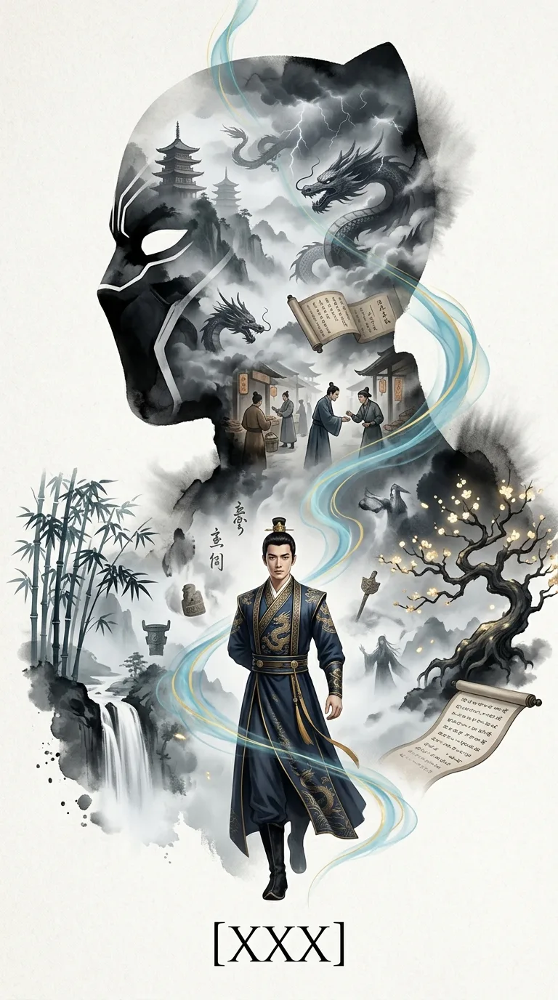

# Character promotional poster for “ XXX ”, a unified

[← Back to the collection](../../README.md) · Category: [Illustration & 3D](../../gallery/illustration-3d.md) · Model: `Vinano Image Pro` · ID: `vn-01188`

<a href="https://vinano.ai?utm_source=github&utm_medium=readme&utm_campaign=awesome-image-video-prompts-updating&utm_content=prompt-page-image"></a>

<sub>Preview generated with <a href="https://vinano.ai?utm_source=github&utm_medium=readme&utm_campaign=awesome-image-video-prompts-updating&utm_content=prompt-page-caption">vinano.ai</a></sub>

## Prompt

```text
Create a character promotional poster for “[XXX]”, a unified vertical (portrait) key visual composition.
Each poster follows a hierarchy of large top / smaller bottom structure:
The upper half of the composition features a highly recognizable large silhouette of the character — focusing on the head, facial contour, mask, or upper-body outline — forming a bold and iconic primary visual.
The middle to lower section includes a full-body version of the character as the secondary subject, shown in a stable standing pose or subtle motion, serving as the visual core of the composition.
Inside the large silhouette and around the character, apply double exposure and collage-style storytelling, blending multiple scenes, symbolic elements, small character interactions, supporting visuals, and environments into layered compositions of mist, ink wash, and negative space.
On both the left and right sides, place complementary supporting elements to create narrative tension and spatial balance.
A flowing visual line should run through the entire composition (top to bottom), connecting the main character, internal collage elements, and the large silhouette above — enhancing cohesion and guiding the viewer’s eye.
The overall composition should preserve large areas of negative space, edges treated ink diffusion, soft blurring, and fragmented fading, evoking an Eastern aesthetic of balance between emptiness and form.
The overall style should feel refined, restrained, premium, and cohesive, emphasizing depth, storytelling, strong visual impact, and a consistent series identity.
Aspect ratio: 9:16.

Render with rich micro-detail while keeping the layout uncluttered and intentional.
```

## Try it on vinano.ai

1. Copy the prompt above.
2. Open **[vinano.ai](https://vinano.ai?utm_source=github&utm_medium=readme&utm_campaign=awesome-image-video-prompts-updating&utm_content=prompt-page-try)**, paste it into the image generator and pick a model.
3. Swap any placeholders (brand, product, city, person…) for your own details, then generate.

More prompts like this: [Illustration & 3D gallery](../../gallery/illustration-3d.md) · [all categories](../../README.md#contents)
