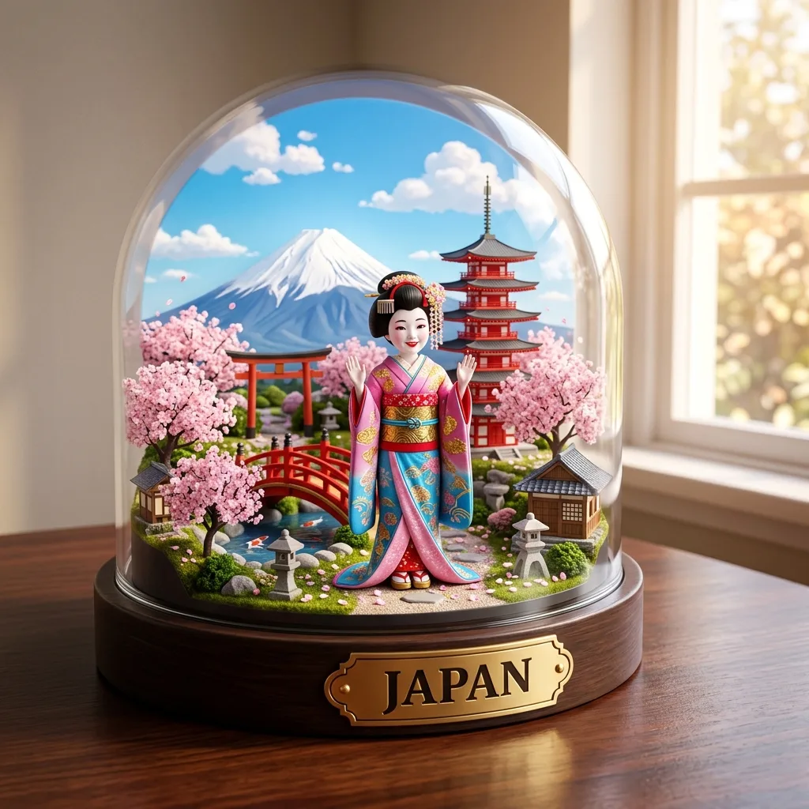

# Highly detailed, hyper-realistic image of a miniature diorama inside

[← Back to the collection](../../README.md) · Category: [Illustration & 3D](../../gallery/illustration-3d.md) · Model: `Vinano Image Pro` · ID: `vn-01194`

<a href="https://vinano.ai?utm_source=github&utm_medium=readme&utm_campaign=awesome-image-video-prompts-updating&utm_content=prompt-page-image"></a>

<sub>Preview generated with <a href="https://vinano.ai?utm_source=github&utm_medium=readme&utm_campaign=awesome-image-video-prompts-updating&utm_content=prompt-page-caption">vinano.ai</a></sub>

## Prompt

```text
Create a highly detailed, hyper-realistic image of a miniature diorama inside a glass dome, placed on a wooden table near a softly lit window. Inside the dome, show a [COUNTRY] cultural figure iconic attire, prominently positioned in the center foreground taking up significant space in the composition to really “pop” from the scene, smiling and waving, in a stylized 3D miniature version of [COUNTRY]’s iconic setting. Include the most iconic background features of that location, all scaled in a whimsical, miniature style. The time of day, season, and mood will vary by [COUNTRY]’s cultural theme. The scene is captured from a slightly elevated perspective. The base of the dome has a wooden plaque bold, gold-colored text labeled: ‘[COUNTRY]’ in a strong, readable font that stands out prominently. The scene should be bright, magical, joyful, and feel like a collectible souvenir moment from a dream trip. Aspect ratio: 1080x1080 Keep edges clean and the overall composition balanced for a polished, gallery-ready result.
```

## Try it on vinano.ai

1. Copy the prompt above.
2. Open **[vinano.ai](https://vinano.ai?utm_source=github&utm_medium=readme&utm_campaign=awesome-image-video-prompts-updating&utm_content=prompt-page-try)**, paste it into the image generator and pick a model.
3. Swap any placeholders (brand, product, city, person…) for your own details, then generate.

More prompts like this: [Illustration & 3D gallery](../../gallery/illustration-3d.md) · [all categories](../../README.md#contents)
