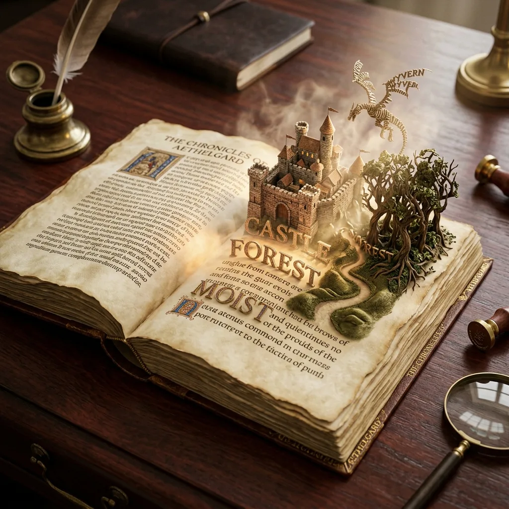

# Insert book title or genre Logic Steps

[← Back to the collection](../../README.md) · Category: [Illustration & 3D](../../gallery/illustration-3d.md) · Model: `Vinano Image Pro` · ID: `vn-01208`

<a href="https://vinano.ai?utm_source=github&utm_medium=readme&utm_campaign=awesome-image-video-prompts-updating&utm_content=prompt-page-image"></a>

<sub>Preview generated with <a href="https://vinano.ai?utm_source=github&utm_medium=readme&utm_campaign=awesome-image-video-prompts-updating&utm_content=prompt-page-caption">vinano.ai</a></sub>

## Prompt

```text
[insert book title or genre]

 Logic Steps:

1. The Paper: Determine age and quality. (Crisp white for Sci-Fi, yellowed crumbling edges for Horror, vellum for Fantasy).

2. The Typography: The letters themselves unglue from the page and stack to form the 3D structures. Examples: The word "Castle" forms the bricks of a fortress. "Forest" forms the trunks of trees.

3. The Atmosphere: Mist or light spilling out from between the pages.

4. The Desk: The surrounding surface matches the likely reader (Mahogany desk for Sherlock Holmes, metal grate for Cyberpunk). Output Rules: 45-degree angle looking down, focus on the paper texture and text transformation.

Maintain consistent colour harmony and crisp focus across the whole frame.
```

## Try it on vinano.ai

1. Copy the prompt above.
2. Open **[vinano.ai](https://vinano.ai?utm_source=github&utm_medium=readme&utm_campaign=awesome-image-video-prompts-updating&utm_content=prompt-page-try)**, paste it into the image generator and pick a model.
3. Swap any placeholders (brand, product, city, person…) for your own details, then generate.

More prompts like this: [Illustration & 3D gallery](../../gallery/illustration-3d.md) · [all categories](../../README.md#contents)
