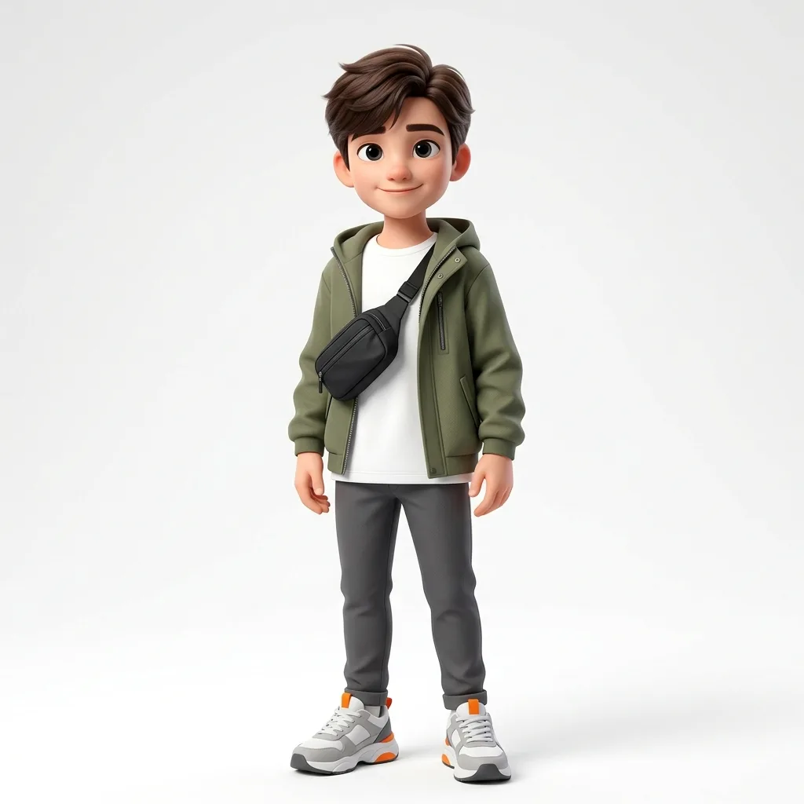

# Full-body 3D stylized cartoon boy, Pixar/Disney-inspired character design, cute

[← Back to the collection](../../README.md) · Category: [Illustration & 3D](../../gallery/illustration-3d.md) · Model: `Vinano Image v2` · ID: `vn-01214`

<a href="https://vinano.ai?utm_source=github&utm_medium=readme&utm_campaign=awesome-image-video-prompts-updating&utm_content=prompt-page-image"></a>

<sub>Preview generated with <a href="https://vinano.ai?utm_source=github&utm_medium=readme&utm_campaign=awesome-image-video-prompts-updating&utm_content=prompt-page-caption">vinano.ai</a></sub>

## Prompt

```text
A full-body 3D stylized cartoon boy, Pixar/Disney-inspired character design, cute and modern look, generated from the provided reference photo. Preserve the subject’s facial structure, proportions, and identity while translating them into a stylized animated form. He has well-groomed short-to-medium hair styled to match the reference, expressive eyes, soft facial features, and a friendly, confident smile.
He is wearing a clean white oversized t-shirt, a high-waisted casual jacket or hoodie (optional), slim-fit pants, and modern sneakers that match the color palette of the outfit. A small crossbody sling bag or backpack adds a trendy touch. Slim proportions, smooth skin, polished 3D render, standing in a relaxed walking or casual pose.
Clean white background, soft studio lighting, high detail, ultra-smooth textures, vibrant yet natural colors, modern fashion doll aesthetic, professional character render, cinematic quality, 4K resolution.

Preserve realistic proportions and depth for a confident, professional finish.
```

## Try it on vinano.ai

1. Copy the prompt above.
2. Open **[vinano.ai](https://vinano.ai?utm_source=github&utm_medium=readme&utm_campaign=awesome-image-video-prompts-updating&utm_content=prompt-page-try)**, paste it into the image generator and pick a model.
3. Swap any placeholders (brand, product, city, person…) for your own details, then generate.

More prompts like this: [Illustration & 3D gallery](../../gallery/illustration-3d.md) · [all categories](../../README.md#contents)
