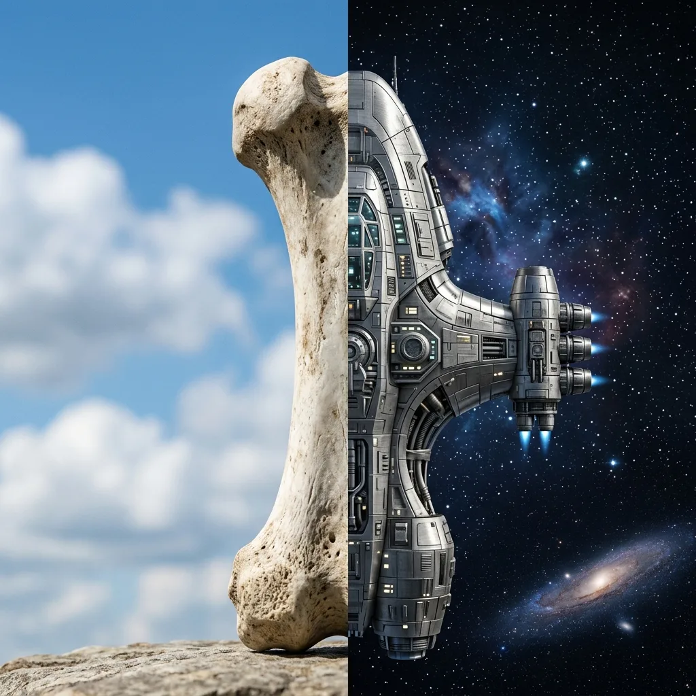

# True-to-life photorealistic image, split down the middle

[← Back to the collection](../../README.md) · Category: [Illustration & 3D](../../gallery/illustration-3d.md) · Model: `Vinano Image v2` · ID: `vn-01222`

<a href="https://vinano.ai?utm_source=github&utm_medium=readme&utm_campaign=awesome-image-video-prompts-updating&utm_content=prompt-page-image"></a>

<sub>Preview generated with <a href="https://vinano.ai?utm_source=github&utm_medium=readme&utm_campaign=awesome-image-video-prompts-updating&utm_content=prompt-page-caption">vinano.ai</a></sub>

## Prompt

```text
A true-to-life photorealistic image, split down the middle. On the left side, a small, detailed bone that touches the center divider, resembling a dog bone set against a clear blue sky clouds in background. On the right side, the bone seamlessly transitions into a detailed, futuristic stunning spacecraft, maintaining the line and shape of the bone against a deep space background scattered stars. The spacecraft extends to the right edge, designed elements that suggest a continuation of the bone's structure. The transition should be smooth, illustrating a creative blend where the organic shape of the bone becomes one the mechanical structure of the spacecraft, set against a neutral background to emphasize the two subjects. Emphasise material texture and natural light so the final frame feels tactile and premium.
```

## Try it on vinano.ai

1. Copy the prompt above.
2. Open **[vinano.ai](https://vinano.ai?utm_source=github&utm_medium=readme&utm_campaign=awesome-image-video-prompts-updating&utm_content=prompt-page-try)**, paste it into the image generator and pick a model.
3. Swap any placeholders (brand, product, city, person…) for your own details, then generate.

More prompts like this: [Illustration & 3D gallery](../../gallery/illustration-3d.md) · [all categories](../../README.md#contents)
