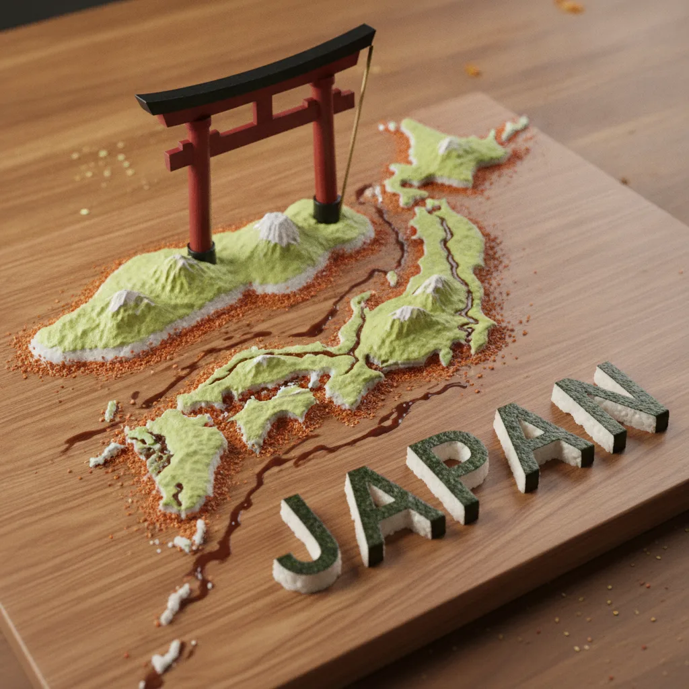

# Charcuterie-style board presents JAPAN as an edible sculpture

[← Back to the collection](../../README.md) · Category: [Illustration & 3D](../../gallery/illustration-3d.md) · Model: `Vinano Image` · ID: `vn-01224`

<a href="https://vinano.ai?utm_source=github&utm_medium=readme&utm_campaign=awesome-image-video-prompts-updating&utm_content=prompt-page-image"></a>

<sub>Preview generated with <a href="https://vinano.ai?utm_source=github&utm_medium=readme&utm_campaign=awesome-image-video-prompts-updating&utm_content=prompt-page-caption">vinano.ai</a></sub>

## Prompt

```text
A charcuterie-style board presents JAPAN as an edible sculpture: • Letters carved from compact sushi-rice blocks wrapped nori trim • Rivers and lakes painted in glossy soy-mirin reduction • Mountain ranges piped in smooth wasabi-avocado mousse (Mount Fuji peak highlighted) • Coastlines dusted shichimi togarashi spice mix Add one iconic red Torii-gate bamboo skewer garnish anchoring the composition. Polarised studio softbox lighting, 50 mm prime, f/4, shallow depth; crumbs, knife marks, and wood-grain preserved. Rendered in Cinema 4D + Octane, 16: 9 warm tabletop scene. (NO text, flags, or extra objects outside the board.) Preserve realistic proportions and depth for a confident, professional finish.
```

## Try it on vinano.ai

1. Copy the prompt above.
2. Open **[vinano.ai](https://vinano.ai?utm_source=github&utm_medium=readme&utm_campaign=awesome-image-video-prompts-updating&utm_content=prompt-page-try)**, paste it into the image generator and pick a model.
3. Swap any placeholders (brand, product, city, person…) for your own details, then generate.

More prompts like this: [Illustration & 3D gallery](../../gallery/illustration-3d.md) · [all categories](../../README.md#contents)
