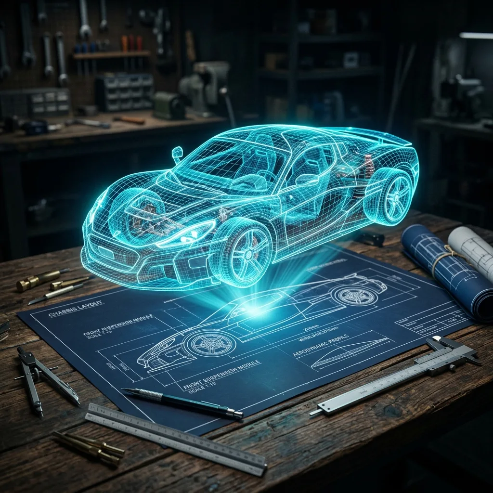

# 3D holographic blueprint projection of a CAR NAME emerging

[← Back to the collection](../../README.md) · Category: [Illustration & 3D](../../gallery/illustration-3d.md) · Model: `Vinano Image Pro` · ID: `vn-01231`

<a href="https://vinano.ai?utm_source=github&utm_medium=readme&utm_campaign=awesome-image-video-prompts-updating&utm_content=prompt-page-image"></a>

<sub>Preview generated with <a href="https://vinano.ai?utm_source=github&utm_medium=readme&utm_campaign=awesome-image-video-prompts-updating&utm_content=prompt-page-caption">vinano.ai</a></sub>

## Prompt

```text
Create a hyper-realistic 3D holographic blueprint projection of a [CAR NAME] emerging as a luminous cyan/blue wireframe model from a dark blue technical blueprint sheet on a wooden workshop table. The car appears as glowing electric blue wireframe lines grid patterns and transparent surfaces, creating a futuristic holographic effect. The 3D model hovers above the flat blueprint drawings dramatic lighting and bright cyan glow. Surround precision drafting tools, compass, rolled blueprints, and technical instruments on dark wooden surface. Dark atmospheric background studio lighting. Aspect ratio: 1:1 (1080x1080 pixels). Do not include any vehicle logos or brand emblems Aim for an editorial, design-driven look with deliberate negative space.
```

## Try it on vinano.ai

1. Copy the prompt above.
2. Open **[vinano.ai](https://vinano.ai?utm_source=github&utm_medium=readme&utm_campaign=awesome-image-video-prompts-updating&utm_content=prompt-page-try)**, paste it into the image generator and pick a model.
3. Swap any placeholders (brand, product, city, person…) for your own details, then generate.

More prompts like this: [Illustration & 3D gallery](../../gallery/illustration-3d.md) · [all categories](../../README.md#contents)
