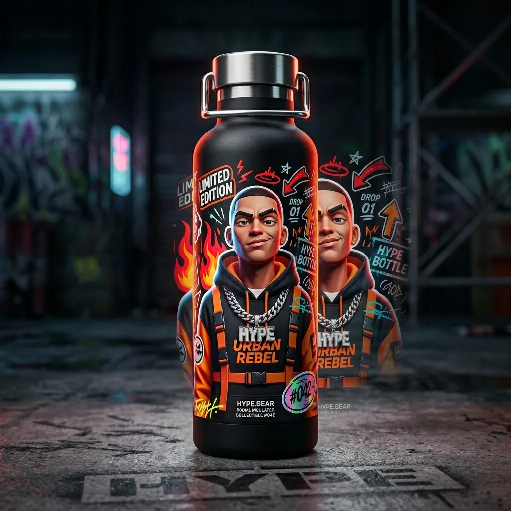

# 8K hype-brand product shot of a collectible thermal bottle

[← Back to the collection](../../README.md) · Category: [Illustration & 3D](../../gallery/illustration-3d.md) · Model: `Vinano Image v2` · ID: `vn-01235`

<a href="https://vinano.ai?utm_source=github&utm_medium=readme&utm_campaign=awesome-image-video-prompts-updating&utm_content=prompt-page-image"></a>

<sub>Preview generated with <a href="https://vinano.ai?utm_source=github&utm_medium=readme&utm_campaign=awesome-image-video-prompts-updating&utm_content=prompt-page-caption">vinano.ai</a></sub>

## Prompt

```text
Ultra-realistic 8K hype-brand product shot of a collectible thermal bottle a sleek matte black finish and bold urban aesthetic. The bottle features a high-detail 3D character based on the attached reference photo, preserving exact facial identity and structure, styled a confident, edgy expression.
The character wears oversized streetwear (premium hoodie layered textures) and a reflective silver chain, inspired by high-end hype fashion. The artwork wraps dynamically around the bottle a slightly distorted, graffiti-inspired layout for a bold visual impact.
Surrounding elements include vibrant pop-art doodles — flames, arrows, stars, scribbles — neon accents (electric red, orange, subtle glow effects), creating a high-energy, limited-edition drop feel. Add subtle glitch effects, sticker-style overlays, and micro-branding details to reinforce exclusivity.
Material realism: soft-touch matte coating fingerprint-level texture, contrasted by glossy UV print highlights and metallic reflections. Cinematic studio lighting strong contrast, rim light glow, and controlled reflections to enhance depth and luxury street appeal.
Shot composition: centered hero product, low-angle perspective for dominance, shallow depth of field, ultra-clean dark or gradient background. Premium commercial photography style mixed urban fashion campaign energy. Hyper-detailed, true-to-life photorealistic, high contrast, sharp focus.

Preserve realistic proportions and depth for a confident, professional finish.
```

## Try it on vinano.ai

1. Copy the prompt above.
2. Open **[vinano.ai](https://vinano.ai?utm_source=github&utm_medium=readme&utm_campaign=awesome-image-video-prompts-updating&utm_content=prompt-page-try)**, paste it into the image generator and pick a model.
3. Swap any placeholders (brand, product, city, person…) for your own details, then generate.

More prompts like this: [Illustration & 3D gallery](../../gallery/illustration-3d.md) · [all categories](../../README.md#contents)
