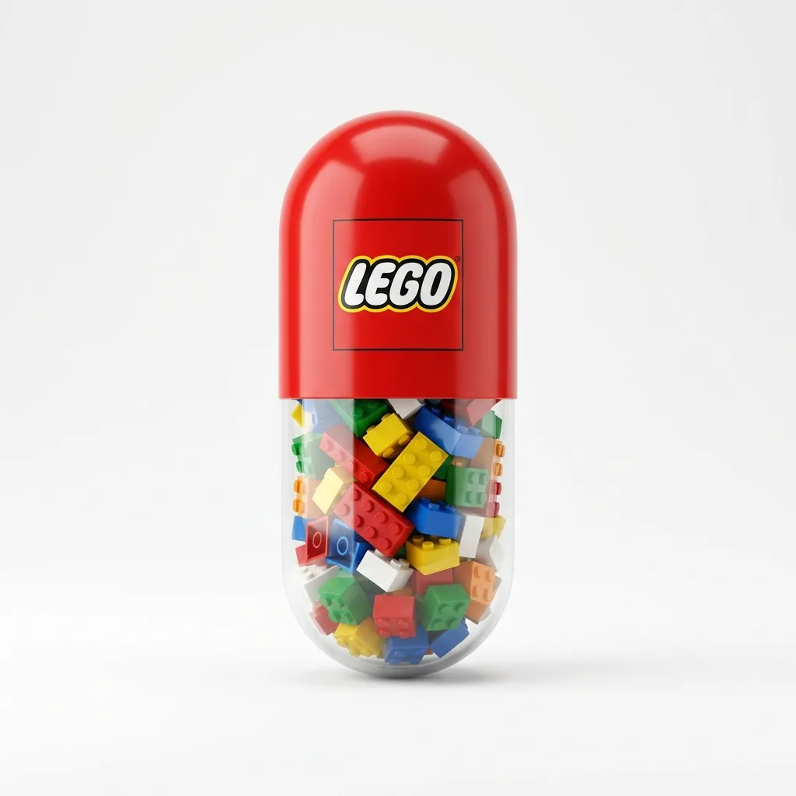

# Illustration & 3D prompt #1241

[← Back to the collection](../../README.md) · Category: [Illustration & 3D](../../gallery/illustration-3d.md) · Model: `Vinano Image Pro` · ID: `vn-01241`

<a href="https://vinano.ai?utm_source=github&utm_medium=readme&utm_campaign=awesome-image-video-prompts-updating&utm_content=prompt-page-image"></a>

<sub>Preview generated with <a href="https://vinano.ai?utm_source=github&utm_medium=readme&utm_campaign=awesome-image-video-prompts-updating&utm_content=prompt-page-caption">vinano.ai</a></sub>

## Prompt

```text
Create a minimal poster. A large capsule pill centered in the frame. The top half of the pill is solid colored and features the [BRAND] logo clearly printed on it. The bottom half of the pill is transparent glass. Inside the transparent part of the capsule, fill it a large amount of [OBJECT] related to the brand. Ultra clean white studio background, soft shadows, high-end product photography lighting, glossy realistic materials, highly detailed, minimal design, centered composition, modern advertising style.​​​​​​​​​​​​​​​​ 1080x1080 dimension. Aim for an editorial, design-driven look with deliberate negative space.
```

## Try it on vinano.ai

1. Copy the prompt above.
2. Open **[vinano.ai](https://vinano.ai?utm_source=github&utm_medium=readme&utm_campaign=awesome-image-video-prompts-updating&utm_content=prompt-page-try)**, paste it into the image generator and pick a model.
3. Swap any placeholders (brand, product, city, person…) for your own details, then generate.

More prompts like this: [Illustration & 3D gallery](../../gallery/illustration-3d.md) · [all categories](../../README.md#contents)
