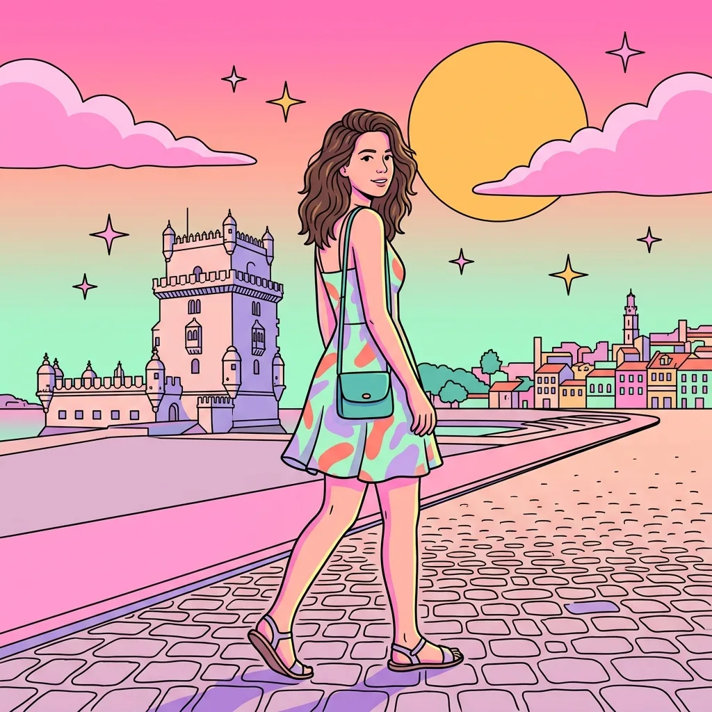

# Convert the person in the attached reference photo into

[← Back to the collection](../../README.md) · Category: [Illustration & 3D](../../gallery/illustration-3d.md) · Model: `Vinano Image v2` · ID: `vn-01243`

<a href="https://vinano.ai?utm_source=github&utm_medium=readme&utm_campaign=awesome-image-video-prompts-updating&utm_content=prompt-page-image"></a>

<sub>Preview generated with <a href="https://vinano.ai?utm_source=github&utm_medium=readme&utm_campaign=awesome-image-video-prompts-updating&utm_content=prompt-page-caption">vinano.ai</a></sub>

## Prompt

```text
Convert the person in the attached reference photo into a
hyper-vibrant 80s pop-art illustration.

CHARACTER:
- Faithfully recreate the person's facial features, skin tone,
 hair color, and hair style from the reference photo
- Automatically detect if the person is male or female and dress
 them accordingly in relatable, everyday casual wear:

 IF FEMALE → light summer dress or casual crop top high-waist jeans or linen trousers, simple sandals or
 white sneakers, a small shoulder bag, minimal jewelry —
 outfits a real person would actually wear on a day out

 IF MALE → plain crew-neck tee or casual open shirt over
 a basic tee, slim chinos or relaxed jeans, clean sneakers
 or loafers, optional watch or crossbody bag — everyday
 street-ready look

- All clothing rendered in the pastel-neon color palette of
 the art style — pinks, mints, lavenders, corals — but the
 silhouette and style remain realistic and wearable
- Place them in a fun, natural candid pose — mid-walk,
 looking over the shoulder, sitting on steps, leaning
 casually, or glancing upward — as if caught in a real moment
- Bold black outlines on the entire figure, flat color fills,
 minimal graphic shading

BACKGROUND:
- The setting is Portugal— depict its most recognizable
 landmark, skyline, street, or scenery prominently
- Render the entire background in hyper-vibrant pop-art
 illustration style: bold outlines, flat pastel-neon fills,
 no photorealism
- Sky: warm gradient of hot pink to peach to mint, large
 solid yellow or orange sun, puffy candy-pink clouds,
 and scattered 4-point sparkle stars

COLOR PALETTE:
Hot pink bubblegum pink, mint green
teal, lavender, coral, yellow-gold

STYLE KEYWORDS:
80s pop-art, flat illustration, bold black outlines, pastel neon,
anime-adjacent, retro sun-drenched, vibrant graphic novel aesthetic,
no photorealism, clean cel-shaded look, relatable everyday fashion

Aim for an editorial, design-driven look with deliberate negative space.
```

## Try it on vinano.ai

1. Copy the prompt above.
2. Open **[vinano.ai](https://vinano.ai?utm_source=github&utm_medium=readme&utm_campaign=awesome-image-video-prompts-updating&utm_content=prompt-page-try)**, paste it into the image generator and pick a model.
3. Swap any placeholders (brand, product, city, person…) for your own details, then generate.

More prompts like this: [Illustration & 3D gallery](../../gallery/illustration-3d.md) · [all categories](../../README.md#contents)
