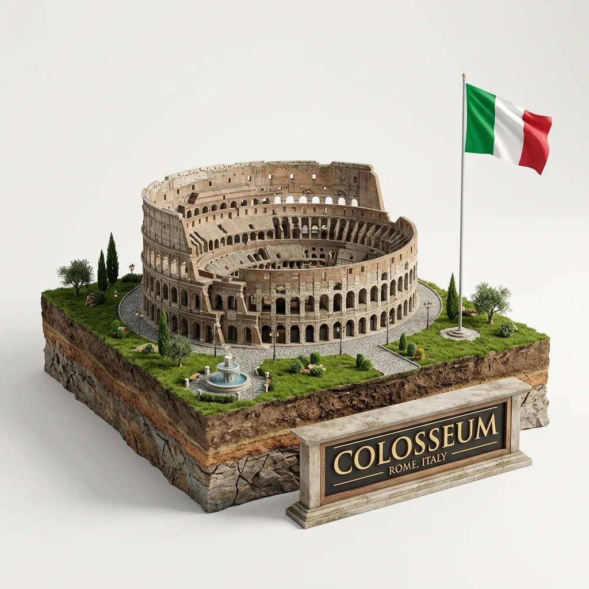

# 3D diorama-style model of LANDMARK NAME

[← Back to the collection](../../README.md) · Category: [Illustration & 3D](../../gallery/illustration-3d.md) · Model: `Vinano Image Pro` · ID: `vn-01246`

<a href="https://vinano.ai?utm_source=github&utm_medium=readme&utm_campaign=awesome-image-video-prompts-updating&utm_content=prompt-page-image"></a>

<sub>Preview generated with <a href="https://vinano.ai?utm_source=github&utm_medium=readme&utm_campaign=awesome-image-video-prompts-updating&utm_content=prompt-page-caption">vinano.ai</a></sub>

## Prompt

```text
Create a hyper-realistic 3D diorama-style model of [LANDMARK NAME]. The model should appear as a miniature, set on a raised cross-section of earth that reveals soil and rock layers beneath a lush grassy surface. The structure must be highly detailed and proportionally accurate, surrounded by tiny realistic elements like region-appropriate street lamps, native trees, shrubs, water features like small fountains, and historically or culturally fitting pathways. The scene should evoke the unique character of [LANDMARK NAME]’s surrounding landscape. The environment must include a soft white background to draw full attention to the model. Include the text “[LANDMARK NAME]” in large, bold, elegant lettering prominently displayed on a big sign or billboard at the front of the diorama, easily readable and eye-catching, along a large national flag on a tall, prominent flagpole positioned beside [LANDMARK NAME], clearly visible and waving. 1080x1080 dimension Aim for an editorial, design-driven look with deliberate negative space.
```

## Try it on vinano.ai

1. Copy the prompt above.
2. Open **[vinano.ai](https://vinano.ai?utm_source=github&utm_medium=readme&utm_campaign=awesome-image-video-prompts-updating&utm_content=prompt-page-try)**, paste it into the image generator and pick a model.
3. Swap any placeholders (brand, product, city, person…) for your own details, then generate.

More prompts like this: [Illustration & 3D gallery](../../gallery/illustration-3d.md) · [all categories](../../README.md#contents)
