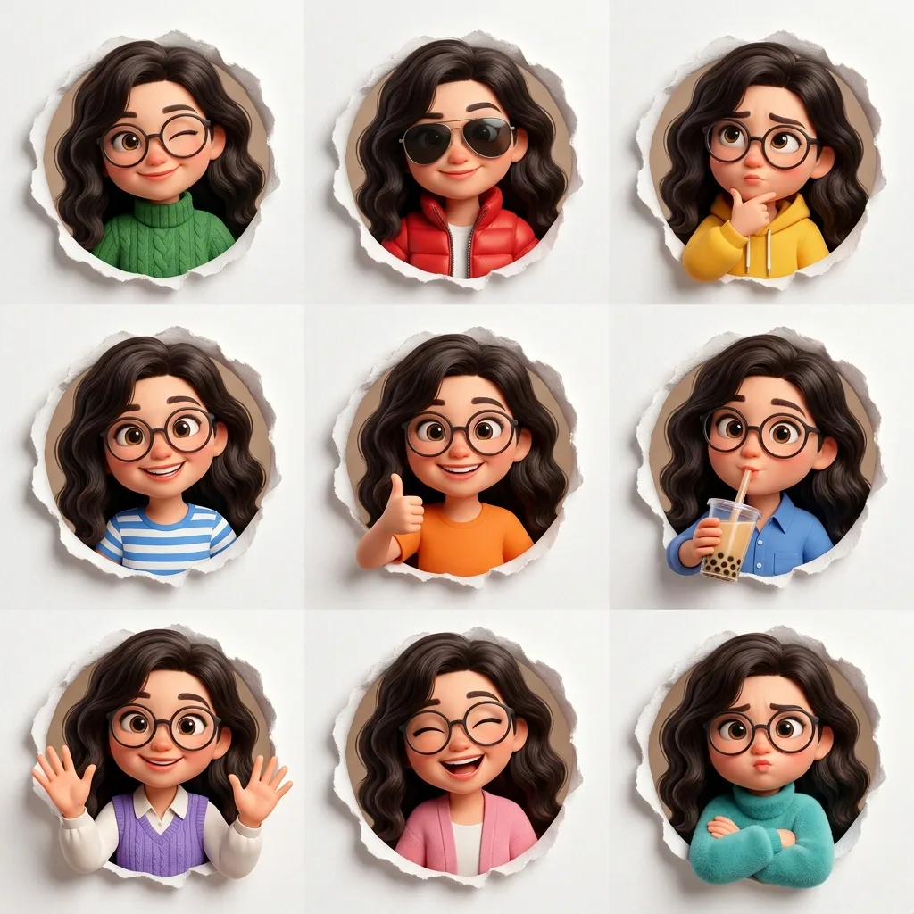

# 3D Pixar-style expression sheet, cute stylized avatar wavy dark

[← Back to the collection](../../README.md) · Category: [Illustration & 3D](../../gallery/illustration-3d.md) · Model: `Vinano Image Pro` · ID: `vn-01252`

<a href="https://vinano.ai?utm_source=github&utm_medium=readme&utm_campaign=awesome-image-video-prompts-updating&utm_content=prompt-page-image"></a>

<sub>Preview generated with <a href="https://vinano.ai?utm_source=github&utm_medium=readme&utm_campaign=awesome-image-video-prompts-updating&utm_content=prompt-page-caption">vinano.ai</a></sub>

## Prompt

```text
3D Pixar-style expression sheet, cute stylized avatar wavy dark hair and round glasses, 3x3 grid layout, peeking through torn paper circles, emotions: wink, sunglasses cool, thinking, happy smile, thumbs up, drinking boba tea, friendly wave, laughing, cute pout, different outfits: green sweater, red jacket, yellow hoodie, striped tee, orange shirt, blue top, purple vest, pink cardigan, teal pullover. Soft filmic, cinematic lighting, clean white background, vibrant colors, high detail, adorable cartoon character, playful expressions, consistent character design across all poses Render with rich micro-detail while keeping the layout uncluttered and intentional.
```

## Try it on vinano.ai

1. Copy the prompt above.
2. Open **[vinano.ai](https://vinano.ai?utm_source=github&utm_medium=readme&utm_campaign=awesome-image-video-prompts-updating&utm_content=prompt-page-try)**, paste it into the image generator and pick a model.
3. Swap any placeholders (brand, product, city, person…) for your own details, then generate.

More prompts like this: [Illustration & 3D gallery](../../gallery/illustration-3d.md) · [all categories](../../README.md#contents)
