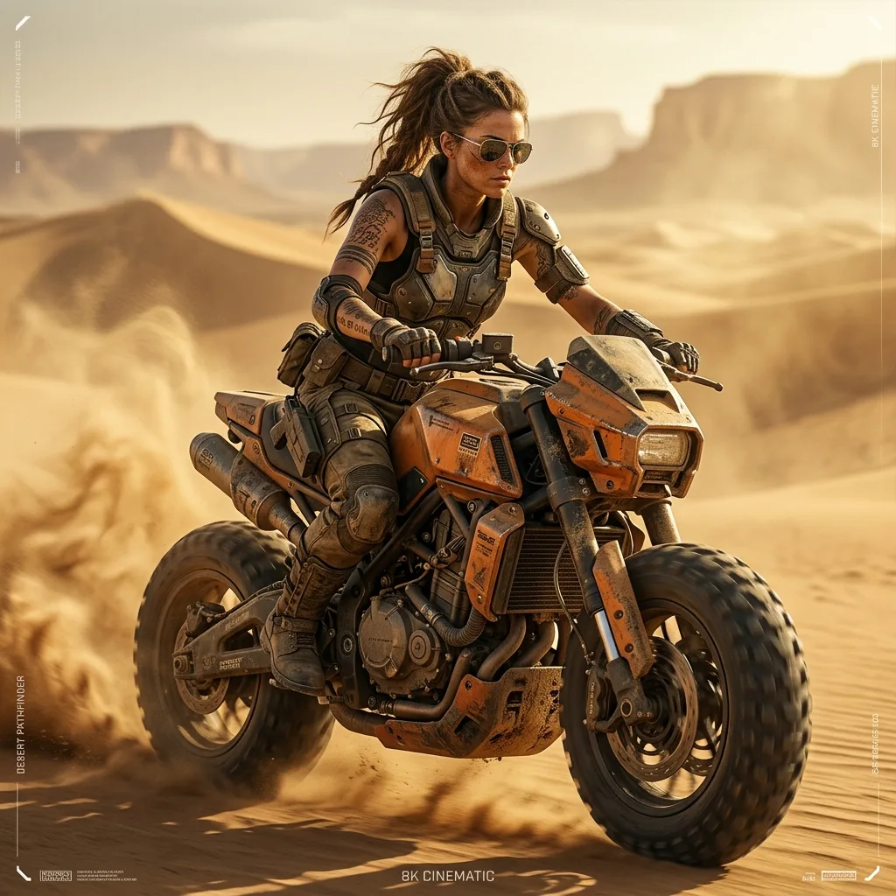

# Use the uploaded picture to create a cinematic sci-fi

[← Back to the collection](../../README.md) · Category: [Illustration & 3D](../../gallery/illustration-3d.md) · Model: `Vinano Image Pro` · ID: `vn-01255`

<a href="https://vinano.ai?utm_source=github&utm_medium=readme&utm_campaign=awesome-image-video-prompts-updating&utm_content=prompt-page-image"></a>

<sub>Preview generated with <a href="https://vinano.ai?utm_source=github&utm_medium=readme&utm_campaign=awesome-image-video-prompts-updating&utm_content=prompt-page-caption">vinano.ai</a></sub>

## Prompt

```text
Use the uploaded picture to create a cinematic sci-fi scene of a fierce futuristic biker riding a heavy armored motorcycle through a vast desert. The person has long hair tied in a messy ponytail, reflective tactical sunglasses, and visible arm tattoos. Wearing a rugged post-apocalyptic outfit layered fabric, utility straps, and armored details.
The motorcycle is bulky and mechanical, oversized tires, exposed machinery, and worn orange metal panels covered in dust. Sand blows around the bike as it moves forward, creating a dramatic motion effect. Warm golden sunlight, hazy atmosphere, shallow depth of field, ultra-realistic textures, high detail, cinematic color grading, epic movie poster style 8K resolution, sharp focus, dramatic lighting.

Keep edges clean and the overall composition balanced for a polished, gallery-ready result.
```

## Try it on vinano.ai

1. Copy the prompt above.
2. Open **[vinano.ai](https://vinano.ai?utm_source=github&utm_medium=readme&utm_campaign=awesome-image-video-prompts-updating&utm_content=prompt-page-try)**, paste it into the image generator and pick a model.
3. Swap any placeholders (brand, product, city, person…) for your own details, then generate.

More prompts like this: [Illustration & 3D gallery](../../gallery/illustration-3d.md) · [all categories](../../README.md#contents)
