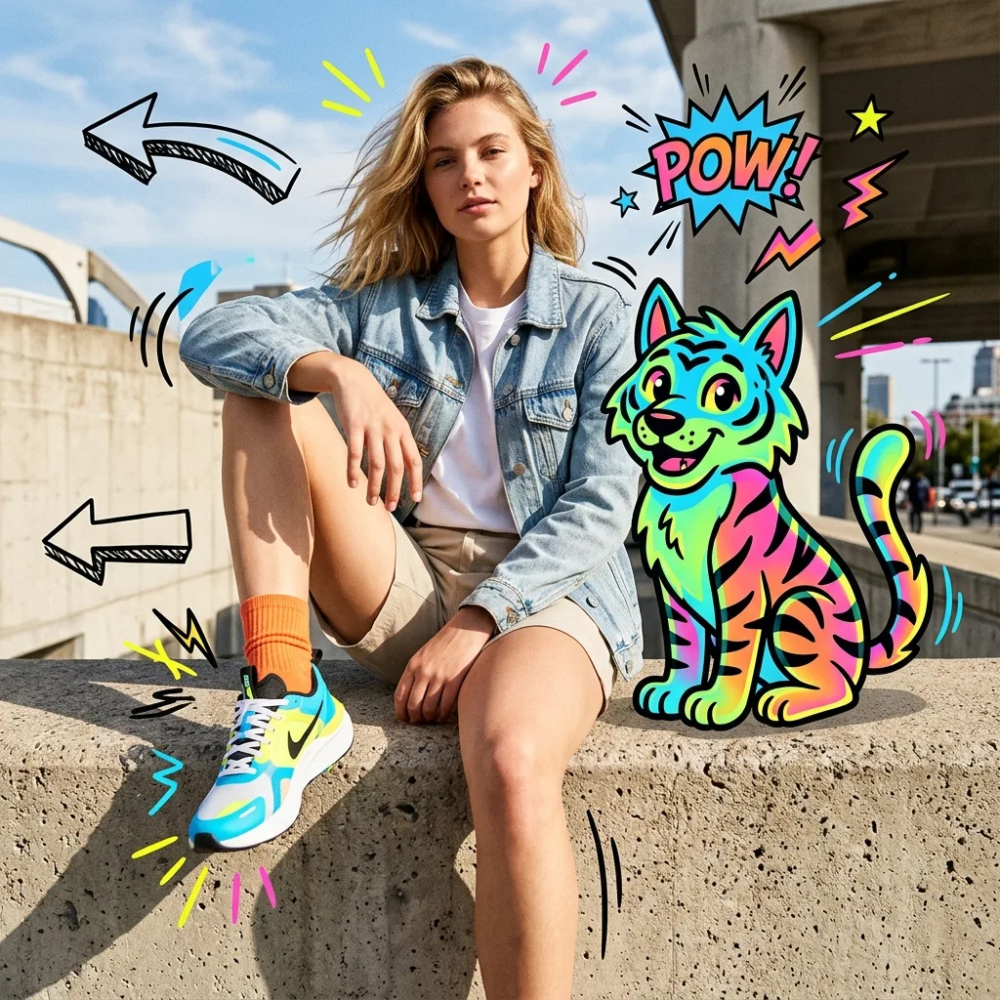

# Full-body fashion editorial shot of a confident young person

[← Back to the collection](../../README.md) · Category: [Illustration & 3D](../../gallery/illustration-3d.md) · Model: `Vinano Image v2` · ID: `vn-01270`

<a href="https://vinano.ai?utm_source=github&utm_medium=readme&utm_campaign=awesome-image-video-prompts-updating&utm_content=prompt-page-image"></a>

<sub>Preview generated with <a href="https://vinano.ai?utm_source=github&utm_medium=readme&utm_campaign=awesome-image-video-prompts-updating&utm_content=prompt-page-caption">vinano.ai</a></sub>

## Prompt

```text
Full-body fashion editorial shot of a confident young person model sitting casually on a concrete ledge, legs slightly apart, one arm resting on knee, the other relaxed, looking straight at camera a calm dominant expression.

Wearing a light denim jacket over a plain white t-shirt, neutral shorts, bright socks, and modern sneakers. Clean styling, natural pose, wind slightly moving hair and fabric.

Beside and partially interacting a stylized cartoon [ANIMAL], positioned naturally as if sharing the same space.

The [ANIMAL] is illustrated in bold cartoon style thick black outlines, vibrant neon color palette (blue, green, yellow accents), exaggerated proportions, expressive features, playful yet powerful presence.

Background: bright outdoor urban setting clear blue sky, soft clouds, sunlit concrete textures, strong natural daylight, crisp shadows.

Fusion of hyper-realistic photography and graphic illustration, seamless integration between subject and cartoon.

Add graphic overlay elements: doodle arrows, scribbles, abstract shapes, comic-style symbols, dynamic motion lines.

High contrast, HDR lighting, sharp focus, fashion editorial composition, surreal mixed-media aesthetic, ultra-detailed, 8k resolution.

Emphasise material texture and natural light so the final frame feels tactile and premium.
```

## Try it on vinano.ai

1. Copy the prompt above.
2. Open **[vinano.ai](https://vinano.ai?utm_source=github&utm_medium=readme&utm_campaign=awesome-image-video-prompts-updating&utm_content=prompt-page-try)**, paste it into the image generator and pick a model.
3. Swap any placeholders (brand, product, city, person…) for your own details, then generate.

More prompts like this: [Illustration & 3D gallery](../../gallery/illustration-3d.md) · [all categories](../../README.md#contents)
