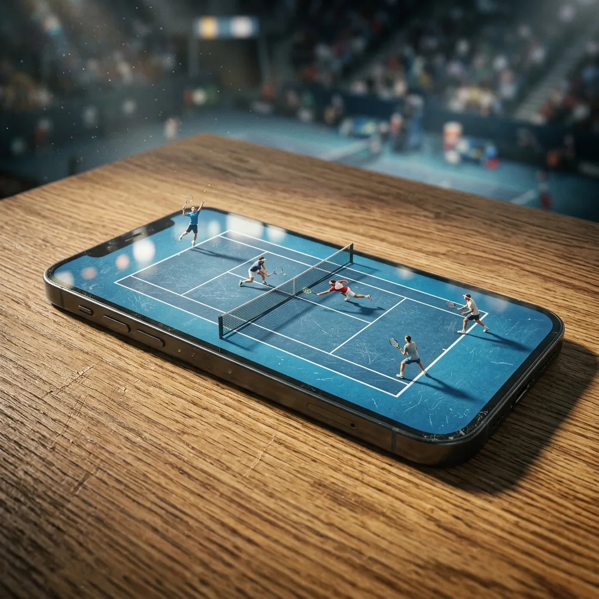

# Smartphone lying on a wooden table

[← Back to the collection](../../README.md) · Category: [Illustration & 3D](../../gallery/illustration-3d.md) · Model: `Vinano Image v2` · ID: `vn-01281`

<a href="https://vinano.ai?utm_source=github&utm_medium=readme&utm_campaign=awesome-image-video-prompts-updating&utm_content=prompt-page-image"></a>

<sub>Preview generated with <a href="https://vinano.ai?utm_source=github&utm_medium=readme&utm_campaign=awesome-image-video-prompts-updating&utm_content=prompt-page-caption">vinano.ai</a></sub>

## Prompt

```text
{
 "type": "image_generation",
 "style": "ultra_realistic_cinematic",
 "aspect_ratio": "3:4",
 "resolution": "8K",
 "camera": {
 "model": "DSLR",
 "lens": "50mm",
 "angle": "dynamic slight tilt, courtside perspective",
 "depth_of_field": "shallow",
 "focus": "sharp on phone and players, soft background blur"
 },
 "scene": {
 "subject": "smartphone lying on a wooden table",
 "concept": "phone screen transformed into a professional tennis court",
 "court_surface": "pristine blue hardcourt fine scratches and chalk marks",
 "players": "miniature tennis players serving, volleying, diving for shots",
 "scale": "realistic miniature proportions"
 },
 "lighting": {
 "type": "dramatic directional lighting",
 "source": "stadium-style lights from the side",
 "effect": "strong highlights and long shadows",
 "reflection": "soft reflection of floodlights on phone glass"
 },
 "details": {
 "phone_surface": ["visible fingerprints",
 "subtle smudges",
 "micro scratches on edges"],
 "atmosphere": ["floating dust particles",
 "light haze for depth"],
 "textures": "hyper-detailed court surface, realistic materials"
 },
 "environment": {
 "table": "natural wood grain texture",
 "background": "softly blurred, cinematic indoor setting"
 },
 "color_grading": {
 "palette": "vibrant yet natural",
 "contrast": "high but balanced",
 "tone": "cinematic realism"
 },
 "aesthetic": {
 "mood": "dynamic, energetic, premium sports visual",
 "style": "high-end sports advertisement"
 },
 "render_quality": {
 "sharpness": "ultra-crisp",
 "detail_level": "extreme",
 "photorealism": "DSLR-grade realism"
 }
}

Maintain consistent colour harmony and crisp focus across the whole frame.
```

## Try it on vinano.ai

1. Copy the prompt above.
2. Open **[vinano.ai](https://vinano.ai?utm_source=github&utm_medium=readme&utm_campaign=awesome-image-video-prompts-updating&utm_content=prompt-page-try)**, paste it into the image generator and pick a model.
3. Swap any placeholders (brand, product, city, person…) for your own details, then generate.

More prompts like this: [Illustration & 3D gallery](../../gallery/illustration-3d.md) · [all categories](../../README.md#contents)
