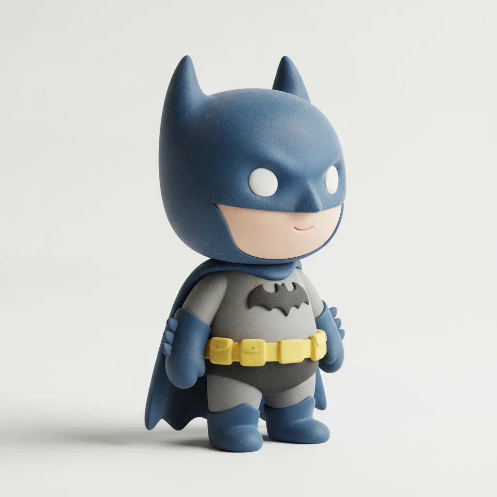

# Stylized miniature model of CHARACTERS shaped entirely from soft

[← Back to the collection](../../README.md) · Category: [Illustration & 3D](../../gallery/illustration-3d.md) · Model: `Vinano Image` · ID: `vn-01286`

<a href="https://vinano.ai?utm_source=github&utm_medium=readme&utm_campaign=awesome-image-video-prompts-updating&utm_content=prompt-page-image"></a>

<sub>Preview generated with <a href="https://vinano.ai?utm_source=github&utm_medium=readme&utm_campaign=awesome-image-video-prompts-updating&utm_content=prompt-page-caption">vinano.ai</a></sub>

## Prompt

```text
Create a stylized miniature model of [CHARACTERS] shaped entirely from soft polymer clay. The figure has rounded, childlike anatomy — large head, small body, and simplified details that feel friendly and handcrafted. Its outfit and accessories match [CHARACTERS]’ iconic look, modeled smooth curves and lively, saturated tones.
The material appears dry and tactile, a powdery matte finish and subtle surface texture—avoid gloss, shine, or reflections. Lighting should be gentle and even, wrapping softly around the form faint ambient shading to reveal volume.
Present the figurine standing upright, slightly turned toward the right, framed in a minimal off-white environment a smooth floor and faint contact shadow beneath. The overall composition feels calm, neat, and balanced—like a clay sculpture photographed for a design catalog.

Keep edges clean and the overall composition balanced for a polished, gallery-ready result.
```

## Try it on vinano.ai

1. Copy the prompt above.
2. Open **[vinano.ai](https://vinano.ai?utm_source=github&utm_medium=readme&utm_campaign=awesome-image-video-prompts-updating&utm_content=prompt-page-try)**, paste it into the image generator and pick a model.
3. Swap any placeholders (brand, product, city, person…) for your own details, then generate.

More prompts like this: [Illustration & 3D gallery](../../gallery/illustration-3d.md) · [all categories](../../README.md#contents)
