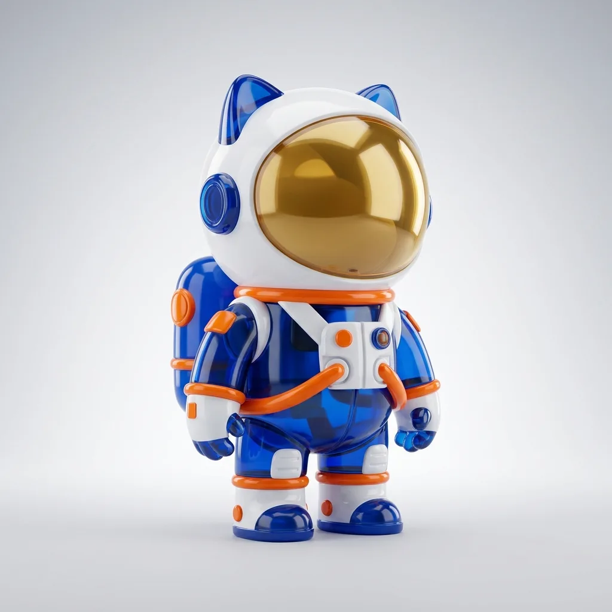

# Premium 3D rendered FIGURE NAME collectible vinyl figure

[← Back to the collection](../../README.md) · Category: [Illustration & 3D](../../gallery/illustration-3d.md) · Model: `Vinano Image v2` · ID: `vn-01296`

<a href="https://vinano.ai?utm_source=github&utm_medium=readme&utm_campaign=awesome-image-video-prompts-updating&utm_content=prompt-page-image"></a>

<sub>Preview generated with <a href="https://vinano.ai?utm_source=github&utm_medium=readme&utm_campaign=awesome-image-video-prompts-updating&utm_content=prompt-page-caption">vinano.ai</a></sub>

## Prompt

```text
Create a premium 3D rendered [FIGURE NAME] collectible vinyl figure in a modern designer toy aesthetic. The figure should feature glossy translucent vinyl material subtle light refraction, bold saturated colors true to the character, and simplified geometric forms smooth curves. Position against a pristine gradient background transitioning from light gray to white. Use professional product photography lighting soft key light from above and gentle rim lighting to highlight the vinyl’s glossy finish. The character should be posed in a confident standing position, centered perfectly in frame. Apply shallow depth of field the figure in sharp focus. Render in ultra-high resolution clean refined minimalist composition, no text, logos, or distracting elements. Square aspect ratio 1080x1080 pixels, true-to-life photorealistic quality crisp details and vibrant color reproduction suitable for premium toy marketing Maintain consistent colour harmony and crisp focus across the whole frame.
```

## Try it on vinano.ai

1. Copy the prompt above.
2. Open **[vinano.ai](https://vinano.ai?utm_source=github&utm_medium=readme&utm_campaign=awesome-image-video-prompts-updating&utm_content=prompt-page-try)**, paste it into the image generator and pick a model.
3. Swap any placeholders (brand, product, city, person…) for your own details, then generate.

More prompts like this: [Illustration & 3D gallery](../../gallery/illustration-3d.md) · [all categories](../../README.md#contents)
