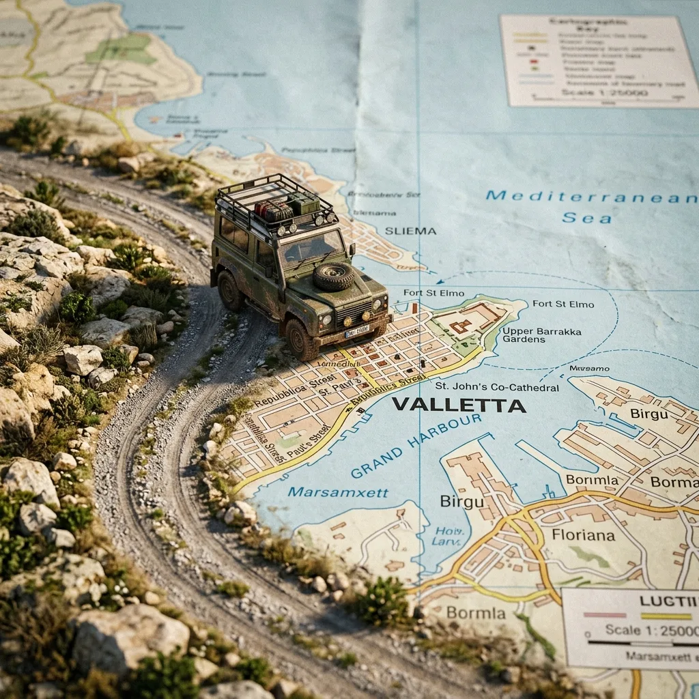

# Surreal, hyper-realistic close-up scene of a miniature CAR driving

[← Back to the collection](../../README.md) · Category: [Illustration & 3D](../../gallery/illustration-3d.md) · Model: `Vinano Image Pro` · ID: `vn-01324`

<a href="https://vinano.ai?utm_source=github&utm_medium=readme&utm_campaign=awesome-image-video-prompts-updating&utm_content=prompt-page-image"></a>

<sub>Preview generated with <a href="https://vinano.ai?utm_source=github&utm_medium=readme&utm_campaign=awesome-image-video-prompts-updating&utm_content=prompt-page-caption">vinano.ai</a></sub>

## Prompt

```text
A surreal, hyper-realistic close-up scene of a miniature [CAR] driving along a winding road that seamlessly transforms into a printed paper map of [CITY], [COUNTRY].

The road transitions naturally into the map’s printed streets, borders, and typography, the vehicle driving directly over the map label “[CITY]”. The surrounding terrain reflects the natural landscape of [COUNTRY] — terrain texture, ground color, and environmental details match the region authentically (e.g. desert, mountains, coast, countryside).

The map features crisp cartographic details, labeled roads, subtle borders, and realistic paper texture. The vehicle is highly detailed and proportionally scaled, feeling tangible and grounded within the scene.

Lighting is bright and natural, directionally cast to create realistic highlights and defined shadows along the road’s curves. Shot from a slightly elevated angle shallow depth of field, keeping the car and map sharply in focus while the background softly fades.

Visual style is cinematic and ultra-realistic, blending tactile paper map textures realistic terrain and vehicle materials.

Aspect ratio 1:1, high resolution, premium editorial quality, no text overlays, no watermark

Aim for an editorial, design-driven look with deliberate negative space.
```

## Try it on vinano.ai

1. Copy the prompt above.
2. Open **[vinano.ai](https://vinano.ai?utm_source=github&utm_medium=readme&utm_campaign=awesome-image-video-prompts-updating&utm_content=prompt-page-try)**, paste it into the image generator and pick a model.
3. Swap any placeholders (brand, product, city, person…) for your own details, then generate.

More prompts like this: [Illustration & 3D gallery](../../gallery/illustration-3d.md) · [all categories](../../README.md#contents)
