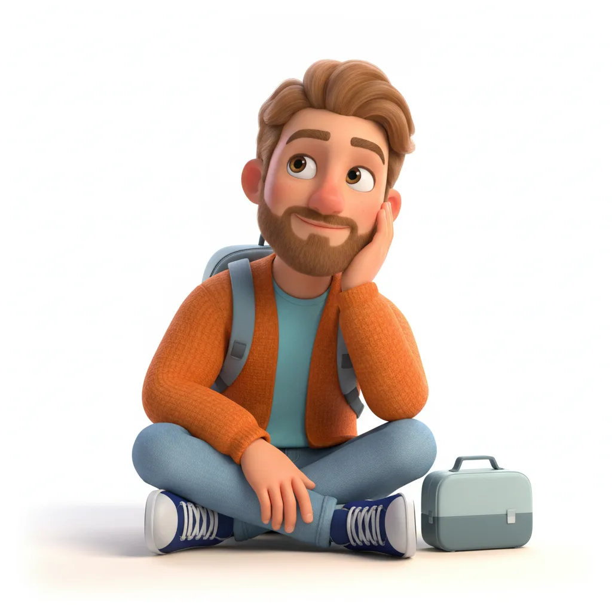

# 3D, Pixar-style animated young man sits cross-legged

[← Back to the collection](../../README.md) · Category: [Illustration & 3D](../../gallery/illustration-3d.md) · Model: `Vinano Image` · ID: `vn-01325`

<a href="https://vinano.ai?utm_source=github&utm_medium=readme&utm_campaign=awesome-image-video-prompts-updating&utm_content=prompt-page-image"></a>

<sub>Preview generated with <a href="https://vinano.ai?utm_source=github&utm_medium=readme&utm_campaign=awesome-image-video-prompts-updating&utm_content=prompt-page-caption">vinano.ai</a></sub>

## Prompt

```text
create a A 3D, Pixar-style animated young man sits cross-legged on a pure white, isolated background. He has bright, olive-toned skin, a neatly styled bright brown haircut a slight wave, and a well-groomed bright brown beard and mustache. His large, expressive eyes, a deep hazel-brown, are slightly upturned and gaze thoughtfully to his left, a subtle, dreamy smile playing on his lips and his right hand resting gently on his cheek.He wears a bright, textured orange knit cardigan over a light blue t-shirt, complemented by bright wash denim jeans. His footwear consists of stylish sneakers a navy blue, grey, and white color scheme. A bright grey, modern backpack is slung over his left shoulder, and a matching bright grey lunchbox rests beside his right leg.The lighting is soft and even, creating gentle highlights on his hair and clothing, and a subtle bright beneath him, emphasizing his rounded, stylized form. The overall mood is one of relaxed contemplation and youthful optimism.. Aim for an editorial, design-driven look with deliberate negative space.
```

## Try it on vinano.ai

1. Copy the prompt above.
2. Open **[vinano.ai](https://vinano.ai?utm_source=github&utm_medium=readme&utm_campaign=awesome-image-video-prompts-updating&utm_content=prompt-page-try)**, paste it into the image generator and pick a model.
3. Swap any placeholders (brand, product, city, person…) for your own details, then generate.

More prompts like this: [Illustration & 3D gallery](../../gallery/illustration-3d.md) · [all categories](../../README.md#contents)
