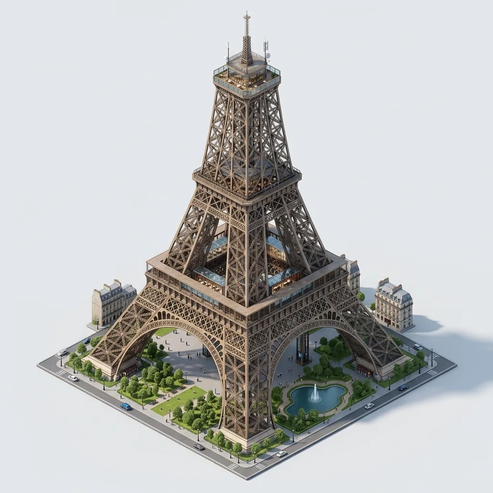

# Highly detailed isometric 3D rendering of LANDMARK in architectural

[← Back to the collection](../../README.md) · Category: [Illustration & 3D](../../gallery/illustration-3d.md) · Model: `Vinano Image Pro` · ID: `vn-01329`

<a href="https://vinano.ai?utm_source=github&utm_medium=readme&utm_campaign=awesome-image-video-prompts-updating&utm_content=prompt-page-image"></a>

<sub>Preview generated with <a href="https://vinano.ai?utm_source=github&utm_medium=readme&utm_campaign=awesome-image-video-prompts-updating&utm_content=prompt-page-caption">vinano.ai</a></sub>

## Prompt

```text
Create a highly detailed isometric 3D rendering of [LANDMARK] in architectural visualization style. The building is shown at a 45-degree angle from above, displaying three visible sides intricate architectural detail. true-to-life photorealistic textures showing materials like stone, glass, metal, or brick. Include the base/ground level tiny people, cars, and landscaping for scale. Clean white or light grey background. Professional architectural rendering soft ambient shadows beneath the structure. Every window, column, ornamental detail, and structural element clearly visible. 1080x1080 dimension, centered composition. Style similar to video game building assets or architectural presentation models - clean, detailed, slightly stylized but realistic. Render with rich micro-detail while keeping the layout uncluttered and intentional.
```

## Try it on vinano.ai

1. Copy the prompt above.
2. Open **[vinano.ai](https://vinano.ai?utm_source=github&utm_medium=readme&utm_campaign=awesome-image-video-prompts-updating&utm_content=prompt-page-try)**, paste it into the image generator and pick a model.
3. Swap any placeholders (brand, product, city, person…) for your own details, then generate.

More prompts like this: [Illustration & 3D gallery](../../gallery/illustration-3d.md) · [all categories](../../README.md#contents)
