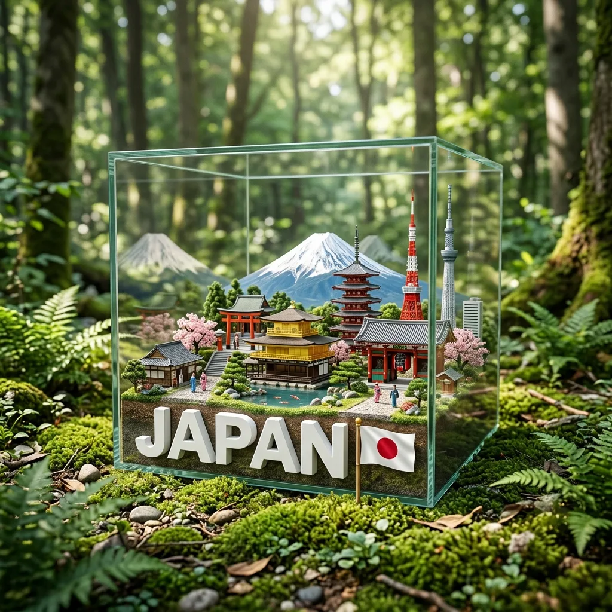

# 1080x1080 photograph of a glass cube diorama placed

[← Back to the collection](../../README.md) · Category: [Illustration & 3D](../../gallery/illustration-3d.md) · Model: `Vinano Image Pro` · ID: `vn-01330`

<a href="https://vinano.ai?utm_source=github&utm_medium=readme&utm_campaign=awesome-image-video-prompts-updating&utm_content=prompt-page-image"></a>

<sub>Preview generated with <a href="https://vinano.ai?utm_source=github&utm_medium=readme&utm_campaign=awesome-image-video-prompts-updating&utm_content=prompt-page-caption">vinano.ai</a></sub>

## Prompt

```text
A hyper-realistic 1080x1080 photograph of a glass cube diorama placed on a lush, mossy forest floor dappled sunlight. Inside the cube are miniature, highly detailed landmarks and cultural icons from [COUNTRY]. Include its most famous and recognizable architecture—traditional and modern—surrounded by greenery. Prominently display the 3D word “COUNTRY” at the base inside the cube, large, bold white block letters and a flagpole of the country's flag. The scene is crisp, elegant, and immersive, the forest background softly blurred to focus on the diorama’s sharp details. Render with rich micro-detail while keeping the layout uncluttered and intentional.
```

## Try it on vinano.ai

1. Copy the prompt above.
2. Open **[vinano.ai](https://vinano.ai?utm_source=github&utm_medium=readme&utm_campaign=awesome-image-video-prompts-updating&utm_content=prompt-page-try)**, paste it into the image generator and pick a model.
3. Swap any placeholders (brand, product, city, person…) for your own details, then generate.

More prompts like this: [Illustration & 3D gallery](../../gallery/illustration-3d.md) · [all categories](../../README.md#contents)
