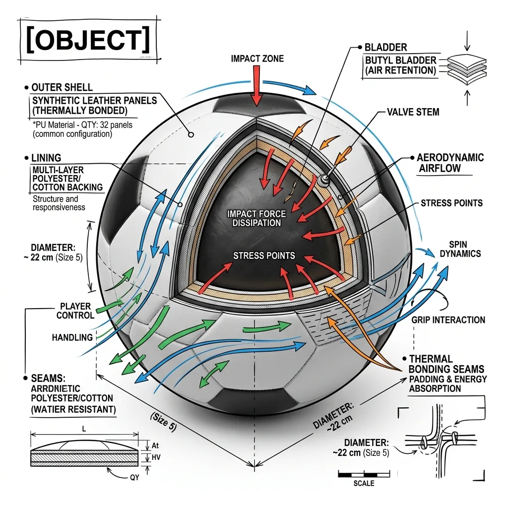

# Technical infographic of OBJECT a 45-degree isometric 3D perspective

[← Back to the collection](../../README.md) · Category: [Illustration & 3D](../../gallery/illustration-3d.md) · Model: `Vinano Image Pro` · ID: `vn-01338`

<a href="https://vinano.ai?utm_source=github&utm_medium=readme&utm_campaign=awesome-image-video-prompts-updating&utm_content=prompt-page-image"></a>

<sub>Preview generated with <a href="https://vinano.ai?utm_source=github&utm_medium=readme&utm_campaign=awesome-image-video-prompts-updating&utm_content=prompt-page-caption">vinano.ai</a></sub>

## Prompt

```text
Create a technical infographic of [OBJECT] a 45-degree isometric 3D perspective, slightly tilted to reveal depth, structure, and internal construction.

Combine a realistic photoreal render black ink technical annotations on a pure white background. Include:
• Key component labels clean callout boxes
• Internal structure visibility through cutaway or exploded sections
• Measurements, dimensions, and scale markers
• Material callouts and quantities
• Color-coded arrows indicating functional systems:
•RED: impact force, collision zones, stress points
•BLUE: airflow, spin, grip interaction, movement dynamics
•GREEN: player control, handling, ergonomics
•ORANGE: padding, reinforcement, energy absorption

Include simple sectional diagrams or force-flow schematics where relevant.

Place the title “[OBJECT]” inside a hand-drawn technical annotation box in the top-left corner.

Style:
Black ink technical linework (architectural / engineering manual style), precise but slightly hand-sketched. The object remains clearly visible beneath annotations. Clean, museum-exhibit / sports engineering vibe.

Perspective:
Isometric 3D angle emphasizing depth, form, and internal architecture — like a professional equipment teardown.

Color palette:
White background, black linework ~10–15% accent color usage (functional arrows only).

Output:
1080×1080, ultra-crisp, social-feed optimized, no watermark.

Keep edges clean and the overall composition balanced for a polished, gallery-ready result.
```

## Try it on vinano.ai

1. Copy the prompt above.
2. Open **[vinano.ai](https://vinano.ai?utm_source=github&utm_medium=readme&utm_campaign=awesome-image-video-prompts-updating&utm_content=prompt-page-try)**, paste it into the image generator and pick a model.
3. Swap any placeholders (brand, product, city, person…) for your own details, then generate.

More prompts like this: [Illustration & 3D gallery](../../gallery/illustration-3d.md) · [all categories](../../README.md#contents)
