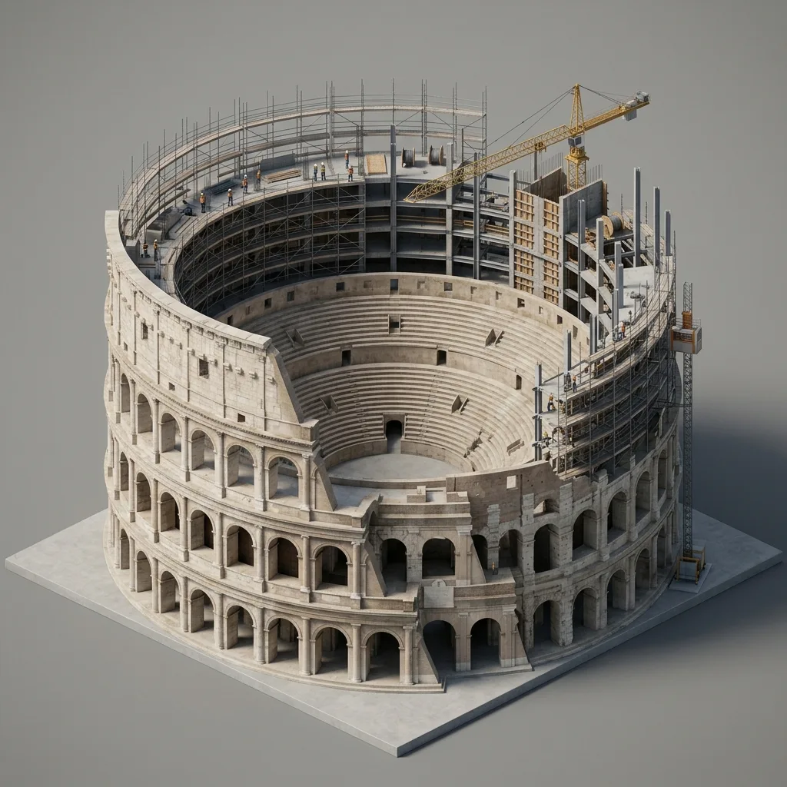

# Depict LANDMARK frozen in an eternal state of construction

[← Back to the collection](../../README.md) · Category: [Illustration & 3D](../../gallery/illustration-3d.md) · Model: `Vinano Image Pro` · ID: `vn-01341`

<a href="https://vinano.ai?utm_source=github&utm_medium=readme&utm_campaign=awesome-image-video-prompts-updating&utm_content=prompt-page-image"></a>

<sub>Preview generated with <a href="https://vinano.ai?utm_source=github&utm_medium=readme&utm_campaign=awesome-image-video-prompts-updating&utm_content=prompt-page-caption">vinano.ai</a></sub>

## Prompt

```text
Depict [LANDMARK] frozen in an eternal state of construction. Camera & Angle (LOCKED): 45° elevated isometric view, camera distance fixed so the full landmark fills ~70% of the frame. No tilt variation. Structure: Lower sections are fully completed, solid, and instantly recognizable. Upper sections transition cleanly into unfinished construction: scaffolding, cranes, exposed beams, cables, and skeletal frameworks. The transition line between finished and unfinished is clearly visible and architecturally precise. Scale & Detail: Include small, static construction workers placed on scaffolding for scale. Include exactly 1–2 construction machines (crane arm, lift, or hoist), frozen in place. No motion, no blur, no debris falling. Materials (CONSISTENT): Finished areas: polished stone / glass / steel (appropriate to the landmark). Unfinished areas: raw concrete, steel beams, cables, structural frames. Materials are clean, realistic, and consistent across all renders. Lighting (LOCKED): Soft neutral filmic, cinematic lighting from upper left. Balanced exposure, gentle shadows, no dramatic highlights. Composition (LOCKED): Perfectly centered, symmetrical balance. Landmark sits on a subtle base or ground plane. Square format 1080×1080. Background (LOCKED): Minimal neutral sky or studio-gray backdrop. No clouds, no gradients, no distractions. Style: Hyper-realistic architectural render. Clean, precise, calm, and monumental. No stylization, no painterly effects. Mood: Timeless, quiet, contemplative. Frozen progress — never finished, never decaying. Preserve realistic proportions and depth for a confident, professional finish.
```

## Try it on vinano.ai

1. Copy the prompt above.
2. Open **[vinano.ai](https://vinano.ai?utm_source=github&utm_medium=readme&utm_campaign=awesome-image-video-prompts-updating&utm_content=prompt-page-try)**, paste it into the image generator and pick a model.
3. Swap any placeholders (brand, product, city, person…) for your own details, then generate.

More prompts like this: [Illustration & 3D gallery](../../gallery/illustration-3d.md) · [all categories](../../README.md#contents)
