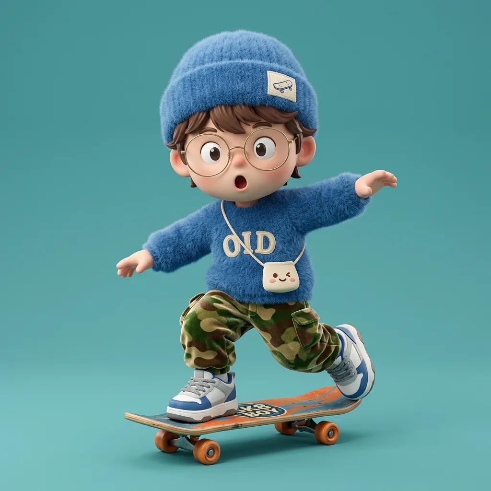

# High-fidelity 3D character render of a cute, stylized boy

[← Back to the collection](../../README.md) · Category: [Illustration & 3D](../../gallery/illustration-3d.md) · Model: `Vinano Image v2` · ID: `vn-01356`

<a href="https://vinano.ai?utm_source=github&utm_medium=readme&utm_campaign=awesome-image-video-prompts-updating&utm_content=prompt-page-image"></a>

<sub>Preview generated with <a href="https://vinano.ai?utm_source=github&utm_medium=readme&utm_campaign=awesome-image-video-prompts-updating&utm_content=prompt-page-caption">vinano.ai</a></sub>

## Prompt

```text
A high-fidelity 3D character render of a cute, stylized boy skateboarding in a dynamic pose. The boy has 'chibi' proportions a large head, wearing oversized round wire-frame glasses and making a surprised 'O' mouth expression. He is dressed in an extremely fuzzy, textured blue mohair sweater the text "OID" on the chest, a matching fuzzy blue beanie a cream patch, and baggy camouflage-patterned pants made of a soft, velvet-like fabric. He wears chunky white sneakers and a small necklace pouch a cartoon face. The background is a solid, seamless teal color. The lighting is soft and diffuse studio lighting, creating a clean, high-end "blind box" art toy aesthetic hyper-realistic fabric textures. Maintain consistent colour harmony and crisp focus across the whole frame.
```

## Try it on vinano.ai

1. Copy the prompt above.
2. Open **[vinano.ai](https://vinano.ai?utm_source=github&utm_medium=readme&utm_campaign=awesome-image-video-prompts-updating&utm_content=prompt-page-try)**, paste it into the image generator and pick a model.
3. Swap any placeholders (brand, product, city, person…) for your own details, then generate.

More prompts like this: [Illustration & 3D gallery](../../gallery/illustration-3d.md) · [all categories](../../README.md#contents)
