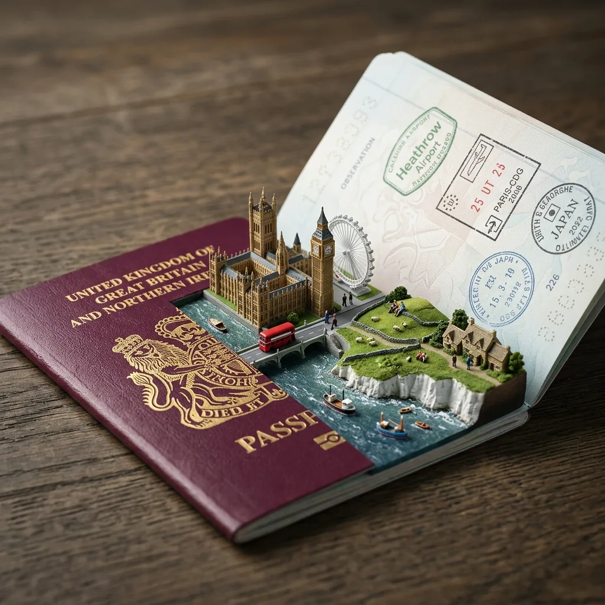

# Open COUNTRY passport on a studio surface, gold-embossed “

[← Back to the collection](../../README.md) · Category: [Illustration & 3D](../../gallery/illustration-3d.md) · Model: `Vinano Image Pro` · ID: `vn-01369`

<a href="https://vinano.ai?utm_source=github&utm_medium=readme&utm_campaign=awesome-image-video-prompts-updating&utm_content=prompt-page-image"></a>

<sub>Preview generated with <a href="https://vinano.ai?utm_source=github&utm_medium=readme&utm_campaign=awesome-image-video-prompts-updating&utm_content=prompt-page-caption">vinano.ai</a></sub>

## Prompt

```text
Hyper-realistic open [COUNTRY] passport on a studio surface, gold-embossed “[Official Passport Name]” text and leather texture. From its pages rises a miniature 3D diorama of [COUNTRY], featuring [ICONIC LANDMARKS], [CITYSCAPES/COASTLINES/COUNTRYSIDE], and tiny human figures for scale. Passport pages show stamps and paper texture. Soft filmic, cinematic lighting, shallow depth of field, ultra-detailed true-to-life photorealistic luxury style. Aim for an editorial, design-driven look with deliberate negative space.
```

## Try it on vinano.ai

1. Copy the prompt above.
2. Open **[vinano.ai](https://vinano.ai?utm_source=github&utm_medium=readme&utm_campaign=awesome-image-video-prompts-updating&utm_content=prompt-page-try)**, paste it into the image generator and pick a model.
3. Swap any placeholders (brand, product, city, person…) for your own details, then generate.

More prompts like this: [Illustration & 3D gallery](../../gallery/illustration-3d.md) · [all categories](../../README.md#contents)
