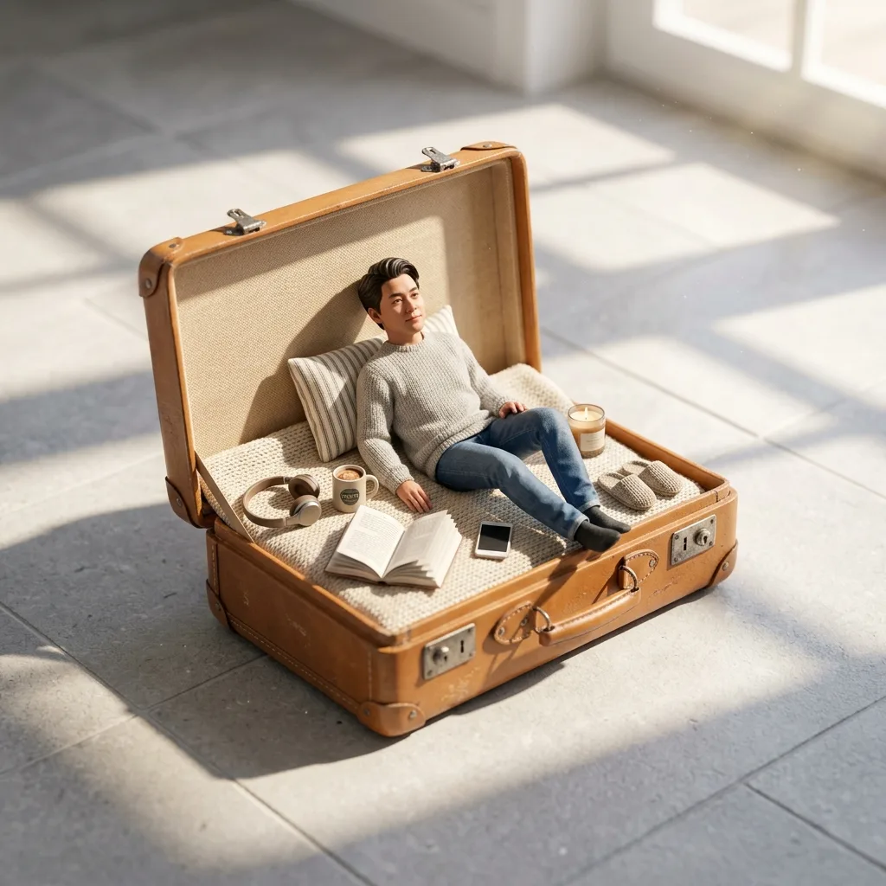

# Ultra-detailed cinematic photo featuring a MINIATURE version

[← Back to the collection](../../README.md) · Category: [Illustration & 3D](../../gallery/illustration-3d.md) · Model: `Vinano Image Pro` · ID: `vn-01370`

<a href="https://vinano.ai?utm_source=github&utm_medium=readme&utm_campaign=awesome-image-video-prompts-updating&utm_content=prompt-page-image"></a>

<sub>Preview generated with <a href="https://vinano.ai?utm_source=github&utm_medium=readme&utm_campaign=awesome-image-video-prompts-updating&utm_content=prompt-page-caption">vinano.ai</a></sub>

## Prompt

```text
{
 "prompt": "Create a hyper-realistic, ultra-detailed cinematic photo featuring a MINIATURE version of the person from the provided reference image (preserve facial likeness, skin tone, hairstyle, and overall identity). The tiny character is relaxing inside an OPEN vintage hard-shell suitcase that is used like a tiny bed. The suitcase sits on a clean stone/tile floor in a bright room strong natural sunlight casting soft rectangular window shadows across the floor.\n\nONLY VARIABLES:\n1) Character: use the user reference photo for the person’s face and identity.\n2) Theme/Genre: {THEME}\n\nCOMPOSITION & SCALE:\n- The person must be clearly mini-sized (toy-scale) relative to the suitcase, correct perspective and believable proportions.\n- The open suitcase interior is styled like a cozy miniature scene: pillow, textured blanket or towel, and themed tiny props.\n- Add realistic micro-details: fabric weave, zipper teeth, suitcase latches, scuffs, stitching, subtle dust, realistic contact shadows.\n\nTHEME STYLING (derive everything from {THEME}):\n- Choose a cohesive color palette and make the SUITCASE COLOR match the theme (e.g., beach = warm coral/sand; football = deep green/black or team-inspired; sporty = bold neon accents; cozy-casual = muted cream/tan; luxury = black/ivory/gold).\n- Dress the tiny character in an outfit that fits {THEME}.\n- Place 5–8 tiny theme props neatly inside the suitcase near the character (miniature scale, photoreal materials). Examples by theme:\n • Beach: tiny sunscreen bottle, mini sunglasses, seashells, flip-flops, mini straw hat, folded towel.\n • Football/Soccer: tiny soccer ball, mini jersey/scarf, cleats, shin guards, whistle, small tactic board.\n • Sporty/Fitness: tiny water bottle, mini dumbbell, resistance band, smartwatch, towel, energy bar.\n • Cozy/Casual: tiny book/magazine, mug, knitted throw, headphones, mini candle.\n(If {THEME} is different, invent equivalent props that strongly communicate that theme.)\n\nLIGHTING & CAMERA:\n- Bright natural sunlight, soft realistic shadows, subtle bounce light, HDR-like dynamic range.\n- Photographic realism: shallow depth of field (but keep face and key props sharp), 50–85mm lens look.\n- No text, no logos, no watermarks.\n\nFINAL LOOK:\n- Hyper-real, high detail, clean editorial product-photography vibe, believable miniature diorama realism, crisp textures and natural skin rendering.",
 "negative_prompt": "cartoon, CGI, illustration, anime, plastic-looking skin, uncanny face, distorted anatomy, extra fingers, deformed hands, duplicated limbs, wrong perspective, unrealistic scale, blurry, low-res, noisy, harsh artifacts, over-smoothed, bad shadows, floating objects, cluttered scene, messy background, text, watermark, logo, brand names, extra people, face not matching reference",
 "variables": {
 "THEME": "beach | football | sporty | cozy-casual | luxury | etc.",
 "USER_IMAGE": "reference photo uploaded by the user (required)"
 }
}

Preserve realistic proportions and depth for a confident, professional finish.
```

## Try it on vinano.ai

1. Copy the prompt above.
2. Open **[vinano.ai](https://vinano.ai?utm_source=github&utm_medium=readme&utm_campaign=awesome-image-video-prompts-updating&utm_content=prompt-page-try)**, paste it into the image generator and pick a model.
3. Swap any placeholders (brand, product, city, person…) for your own details, then generate.

More prompts like this: [Illustration & 3D gallery](../../gallery/illustration-3d.md) · [all categories](../../README.md#contents)
