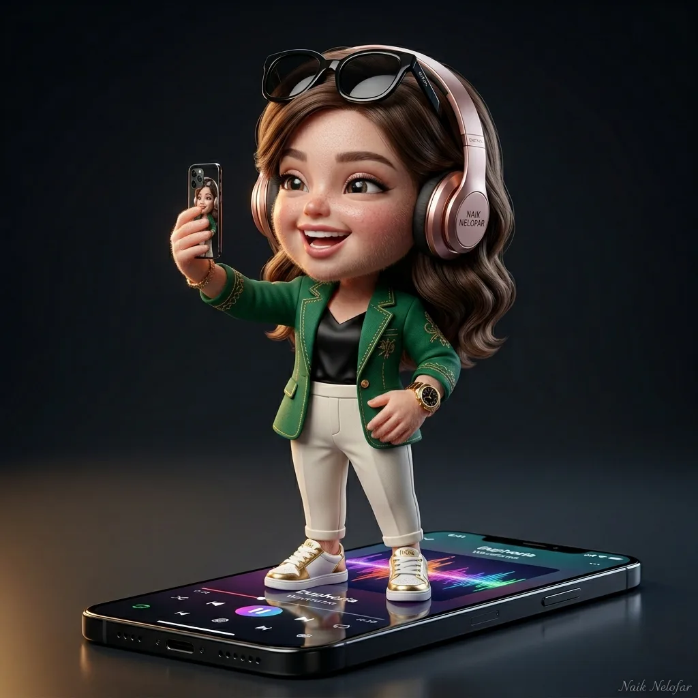

# High-detail 3D semi-realistic chibi character slightly exaggerated cute proportions

[← Back to the collection](../../README.md) · Category: [Illustration & 3D](../../gallery/illustration-3d.md) · Model: `Vinano Image v2` · ID: `vn-01374`

<a href="https://vinano.ai?utm_source=github&utm_medium=readme&utm_campaign=awesome-image-video-prompts-updating&utm_content=prompt-page-image"></a>

<sub>Preview generated with <a href="https://vinano.ai?utm_source=github&utm_medium=readme&utm_campaign=awesome-image-video-prompts-updating&utm_content=prompt-page-caption">vinano.ai</a></sub>

## Prompt

```text
Create a high-detail 3D semi-realistic chibi character slightly exaggerated cute proportions but true-to-life photorealistic facial rendering, natural skin pores, realistic lighting, and finely detailed hair strands. The character should look like a collectible designer toy figure smooth surfaces, high-end materials, and ultra-clean edges. The character is styled in an fashion look: A tailored designer jacket in deep emerald green gold stitching accents A sleek black silk fitted top underneath High-fashion tapered trousers in matte ivory tone  designer sneakers / footwear in white and gold polished details Accessories must feel ultra- and fashionable:  oversized sunglasses glossy black lenses and gold frame   wristwatch metallic gold case and elegant dial Subtle designer bracelet and minimal accents The character stands confidently on top of a giant modern smartphone, like a collectible display piece. They are wearing stylish wireless over-ear headphones in metallic rose gold and holding the phone slightly forward while taking a playful joyful selfie, smiling and laughing energetic expression. The smartphone screen displays a realistic modern music-player interface colorful waveform animations and elegant UI elements. Scene style and lighting: Background: deep cinematic dark brown gradient studio backdrop Lighting: soft studio lighting subtle reflections and rim light Materials: premium-quality fabric textures, polished metals, and realistic plastics Style: collectible toy aesthetic mixed semi-realistic chibi design Camera perspective: Aerial / top-down camera angle Slight cinematic depth of field for realism Rendering quality: Ultra-detailed 3D render 8K resolution smooth shading hyper-clean edges high clarity Add a small elegant watermark text “Naik Nelofar ” at the bottom of the image, subtle but clearly readable. Aspect ratio: 3:4 vertical composition Render with rich micro-detail while keeping the layout uncluttered and intentional.
```

## Try it on vinano.ai

1. Copy the prompt above.
2. Open **[vinano.ai](https://vinano.ai?utm_source=github&utm_medium=readme&utm_campaign=awesome-image-video-prompts-updating&utm_content=prompt-page-try)**, paste it into the image generator and pick a model.
3. Swap any placeholders (brand, product, city, person…) for your own details, then generate.

More prompts like this: [Illustration & 3D gallery](../../gallery/illustration-3d.md) · [all categories](../../README.md#contents)
