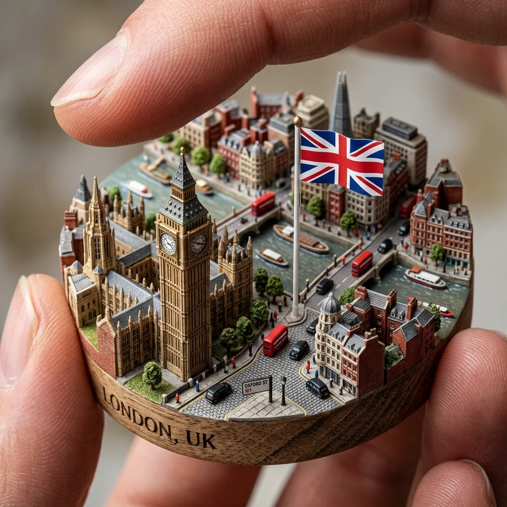

# Extreme close-up macro of miniature city diorama CITY, COUNTRY

[← Back to the collection](../../README.md) · Category: [Illustration & 3D](../../gallery/illustration-3d.md) · Model: `Vinano Image Pro` · ID: `vn-01389`

<a href="https://vinano.ai?utm_source=github&utm_medium=readme&utm_campaign=awesome-image-video-prompts-updating&utm_content=prompt-page-image"></a>

<sub>Preview generated with <a href="https://vinano.ai?utm_source=github&utm_medium=readme&utm_campaign=awesome-image-video-prompts-updating&utm_content=prompt-page-caption">vinano.ai</a></sub>

## Prompt

```text
Extreme close-up macro of miniature city diorama [CITY, COUNTRY] on a solid base, held between two human fingers. City fills 85–95% of frame.
[COUNTRY] national flag stands prominently on flagpole in mid-ground, fully readable, gently waving—primary visual anchor.
[ICONIC LANDMARK] positioned in clear foreground, unobstructed, instantly recognizable, naturally integrated.
Small street sign or plaque displays “[CITY NAME]” as authentic urban detail, positioned organically at street corner or plaza edge.
Surrounding architecture reflects city’s authentic character without oversizing elements.
Ultra-realistic handcrafted miniature, detailed architecture, realistic materials, accurate proportions. Macro lens, deep depth of field keeping entire city sharp. Soft studio lighting, subtle shadows, tilt-shift realism. Neutral softly blurred background. true-to-life photorealistic, cinematic, premium quality.

Maintain consistent colour harmony and crisp focus across the whole frame.
```

## Try it on vinano.ai

1. Copy the prompt above.
2. Open **[vinano.ai](https://vinano.ai?utm_source=github&utm_medium=readme&utm_campaign=awesome-image-video-prompts-updating&utm_content=prompt-page-try)**, paste it into the image generator and pick a model.
3. Swap any placeholders (brand, product, city, person…) for your own details, then generate.

More prompts like this: [Illustration & 3D gallery](../../gallery/illustration-3d.md) · [all categories](../../README.md#contents)
