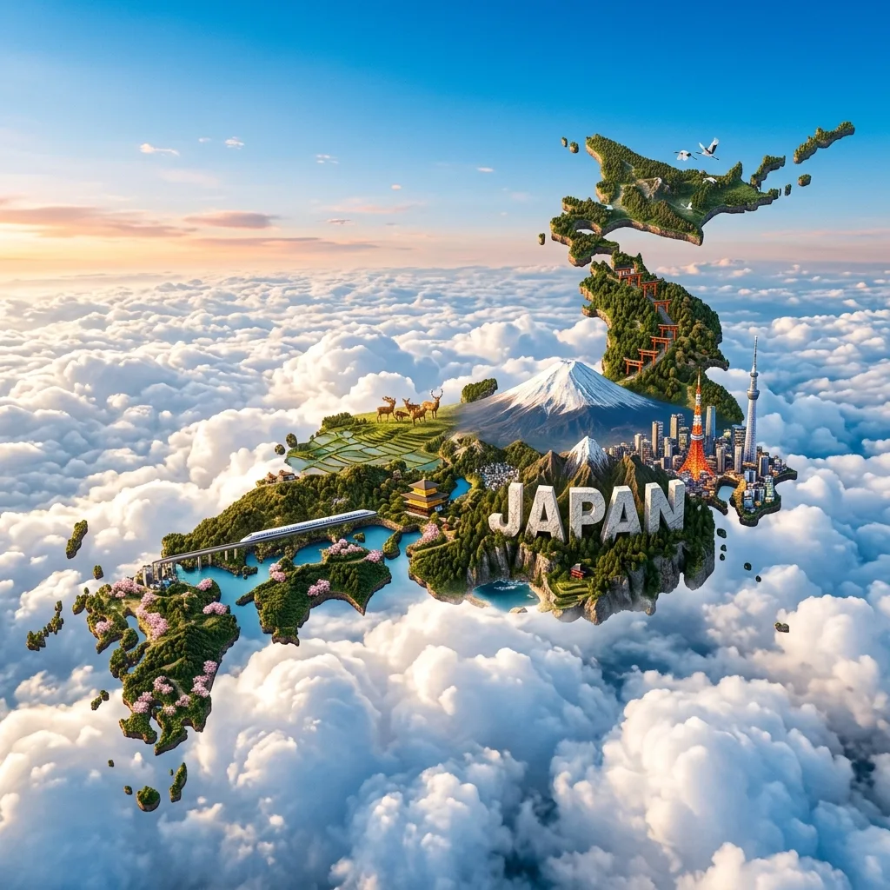

# Ultra-HD, hyper-realistic digital poster of a floating miniature island

[← Back to the collection](../../README.md) · Category: [Illustration & 3D](../../gallery/illustration-3d.md) · Model: `Vinano Image Pro` · ID: `vn-01422`

<a href="https://vinano.ai?utm_source=github&utm_medium=readme&utm_campaign=awesome-image-video-prompts-updating&utm_content=prompt-page-image"></a>

<sub>Preview generated with <a href="https://vinano.ai?utm_source=github&utm_medium=readme&utm_campaign=awesome-image-video-prompts-updating&utm_content=prompt-page-caption">vinano.ai</a></sub>

## Prompt

```text
Create an ultra-HD, hyper-realistic digital poster of a floating miniature island shaped like [Country], resting on white clouds in the sky. Blend iconic landmarks, natural landscapes (like [landmark 1], [landscape 2], or [landscape 3]), and cultural elements unique to [Country]. Carve "[Country]" into the terrain large white 3D letters. Add artistic details like [wildlife], filmic, cinematic lighting, vivid colors, aerial perspective, and sun reflections to enhance realism Keep edges clean and the overall composition balanced for a polished, gallery-ready result.
```

## Try it on vinano.ai

1. Copy the prompt above.
2. Open **[vinano.ai](https://vinano.ai?utm_source=github&utm_medium=readme&utm_campaign=awesome-image-video-prompts-updating&utm_content=prompt-page-try)**, paste it into the image generator and pick a model.
3. Swap any placeholders (brand, product, city, person…) for your own details, then generate.

More prompts like this: [Illustration & 3D gallery](../../gallery/illustration-3d.md) · [all categories](../../README.md#contents)
