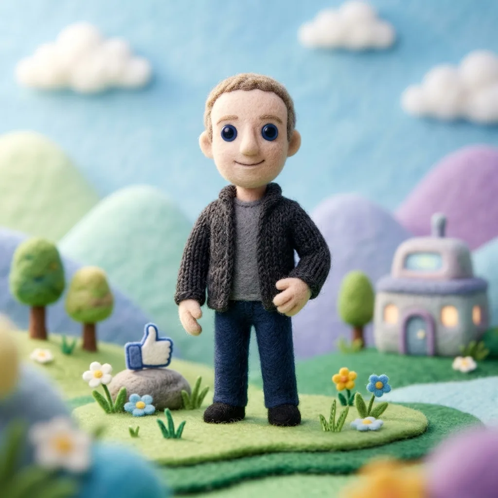

# Handcrafted felt miniature illustration of Celebrity reimagined as

[← Back to the collection](../../README.md) · Category: [Illustration & 3D](../../gallery/illustration-3d.md) · Model: `Vinano Image v2` · ID: `vn-01434`

<a href="https://vinano.ai?utm_source=github&utm_medium=readme&utm_campaign=awesome-image-video-prompts-updating&utm_content=prompt-page-image"></a>

<sub>Preview generated with <a href="https://vinano.ai?utm_source=github&utm_medium=readme&utm_campaign=awesome-image-video-prompts-updating&utm_content=prompt-page-caption">vinano.ai</a></sub>

## Prompt

```text
A handcrafted felt miniature illustration of [Celebrity] reimagined as a soft wool doll character. The figure has simplified facial features, button-like eyes, subtle smile, and carefully crafted felt textures. He is wearing an outfit inspired by his iconic casual tech style—dark jacket, simple t-shirt, and trousers—recreated in knitted wool and fabric. The scene has a whimsical, storybook feel grassy felt terrain, pastel hills, and a bright sky soft clouds. Macro photography look, shallow depth of field, soft natural lighting, stop-motion animation aesthetic, ultra-detailed fibers and fabric textures, cozy yet futuristic mood, cinematic composition, premium quality. Preserve realistic proportions and depth for a confident, professional finish.
```

## Try it on vinano.ai

1. Copy the prompt above.
2. Open **[vinano.ai](https://vinano.ai?utm_source=github&utm_medium=readme&utm_campaign=awesome-image-video-prompts-updating&utm_content=prompt-page-try)**, paste it into the image generator and pick a model.
3. Swap any placeholders (brand, product, city, person…) for your own details, then generate.

More prompts like this: [Illustration & 3D gallery](../../gallery/illustration-3d.md) · [all categories](../../README.md#contents)
